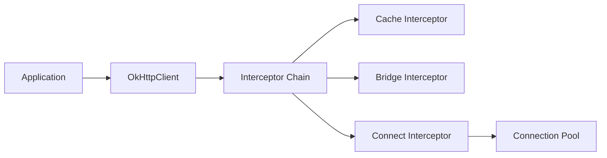

# square/okhttp

> Client HTTP pour Java, Kotlin et Android, avec HTTP/2, pool de connexions, cache et TLS moderne.

## Le problème
Les clients HTTP de base gèrent mal les connexions instables, le multiplexage et les versions récentes de TLS.

## Ce que ça fait vraiment
Envoie des requêtes synchrones ou asynchrones avec constructeurs immuables, via une chaîne d'intercepteurs (cache, pont, connexion). Partage de socket HTTP/2, pool de connexions, GZIP transparent, essai d'adresses alternatives. WebSockets, SSE, épinglage de certificats. Fournit MockWebServer pour les tests.

## Comment c'est branché


## Essayer
```kotlin
implementation("com.squareup.okhttp3:okhttp:5.5.1")
```

## Coût et pièges
Gratuit. Maven : choisir `okhttp-jvm` ou `okhttp-android` (l'artefact `okhttp` y est vide). Android 5.0+ et Java 8+. Mise à jour régulière recommandée pour les correctifs TLS.

## Ce que ce n'est pas
Pas configurable à l'excès : pas de GET avec corps ni d'interface de cache remplaçable. MockWebServer n'évolue plus activement.

## Alternatives
Aucune alternative nommée dans le README (MockServer cité pour les tests).

## Pour toi
À ignorer sauf pile JVM/Android : en Python tu utilises requests ou httpx.

