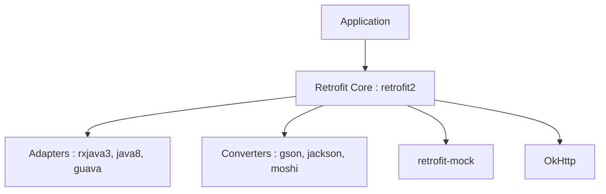

# square/retrofit

> Typed HTTP client for Android and Java, for application developers consuming REST APIs.

## The problem
Calling an HTTP API in Java requires a lot of repetitive code to build requests and convert responses.

## What it actually does
A core (the retrofit folder) builds HTTP calls from interfaces. Adapter modules handle the asynchronous return type (RxJava, Java 8, Guava, Scala) and converters handle formats (Gson, Jackson, Moshi, Protobuf, Wire, Kotlinx-serialization). A mock module is used for testing. OkHttp is a dependency.

## How it is wired


## Trying it
```bash
# Coordonnées Maven citées dans le README
com.squareup.retrofit2:retrofit:3.0.0
```

## Cost and gotchas
Free. Requires Java 8+ or Android API 21+. ProGuard rules must be added by hand outside R8, plus those of OkHttp.

## What it is not
Not an HTTP server. Not usable from Python or JavaScript. Not an API testing tool.

## Alternatives
No alternative named in the README.

## For you
Ignore: an Android / Java library unrelated to data / AI / MLOps work in Python.
