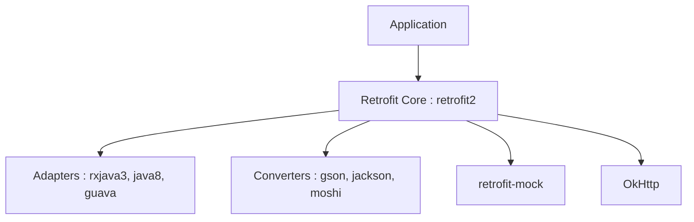

# square/retrofit

> Client HTTP typé pour Android et Java, pour développeurs d'applications consommant des API REST.

## Le problème
Appeler une API HTTP en Java demande beaucoup de code répétitif pour construire les requêtes et convertir les réponses.

## Ce que ça fait vraiment
Un noyau (dossier retrofit) construit les appels HTTP à partir d'interfaces. Des modules d'adaptateurs gèrent le type de retour asynchrone (RxJava, Java 8, Guava, Scala) et des convertisseurs gèrent les formats (Gson, Jackson, Moshi, Protobuf, Wire, Kotlinx-serialization). Un module mock sert aux tests. OkHttp est une dépendance.

## Comment c'est branché


## Essayer
```bash
# Coordonnées Maven citées dans le README
com.squareup.retrofit2:retrofit:3.0.0
```

## Coût et pièges
Gratuit. Exige Java 8+ ou Android API 21+. Règles ProGuard à ajouter à la main hors R8, plus celles d'OkHttp.

## Ce que ce n'est pas
Pas un serveur HTTP. Pas utilisable depuis Python ou JavaScript. Pas un outil de test d'API.

## Alternatives
Aucune alternative nommée dans le README.

## Pour toi
À ignorer : bibliothèque Android / Java sans rapport avec un travail data / IA / MLOps en Python.

