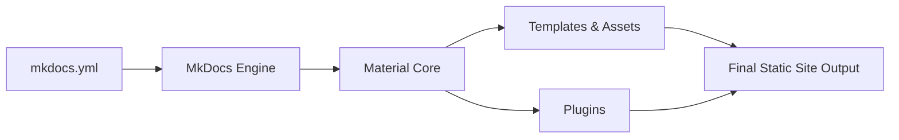

# squidfunk/mkdocs-material

> Theme and documentation framework for MkDocs, for generating a static site from Markdown.

## The problem
Publishing readable, searchable, responsive documentation from Markdown files otherwise takes a lot of HTML, CSS and JavaScript.

## What it actually does
A theme for MkDocs: MkDocs reads `mkdocs.yml` and the Markdown, and the Material theme provides templates, styles, scripts and plugins (blog, search, tags, social, etc.). Customization of colors, fonts, languages (more than 60) and template overrides. The result is a static site that you host yourself. The README lists many projects that use it, including Pydantic, FastAPI and LlamaIndex.

## How it is wired


## Trying it
```bash
pip install mkdocs-material
```
```yaml
theme:
  name: material
```

## Cost and gotchas
Free. Depends on MkDocs. The README shows many sponsors; the main maintainer is a single person judging by the owner's name, which is a dependency to keep an eye on.

## What it is not
It is not a CMS or a host: it produces static files. The README does not detail other deployment options here.

## Alternatives
- No alternative named in the README.

## For you
Adopt: the documentation of your data and MLOps projects in Markdown, versioned with the code, with a professional look in a few lines of config.
