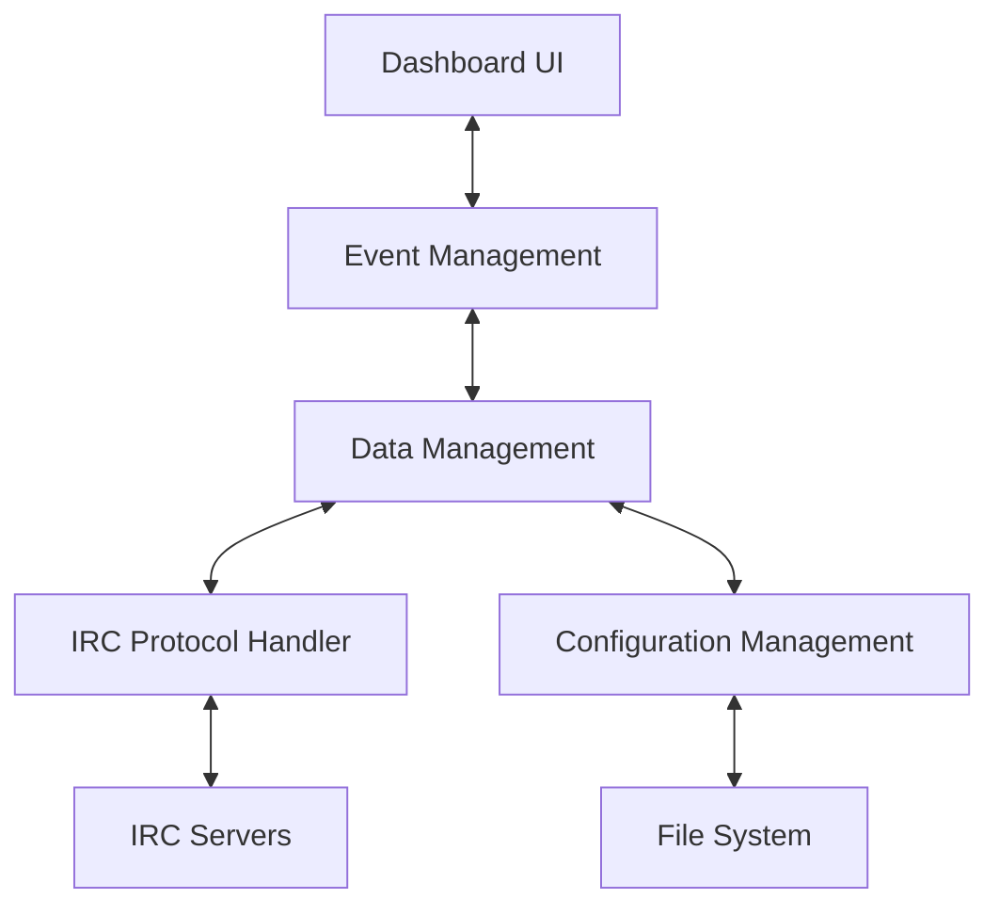

# squidowl/halloy

> Open-source desktop IRC client, simple and fast, for macOS, Windows and Linux.

## The problem
IRC clients are often old, barely configurable or heavy, and handle IRCv3 extensions poorly.

## What it actually does
A desktop application written in Rust with the Iced GUI library. It supports many IRCv3 capabilities (chathistory, multiline, read-marker, SASL 3.1, reactions, soju bouncer). The described architecture separates the interface, the data layer (config, history, file transfers) and the IRC protocol.

## How it is wired
Diagram based on the one provided.

## Trying it
The README gives no command: it points to the installation documentation, Flathub and the Snap Store.

## Cost and gotchas
Free. GPL-3.0 license: copyleft if you embed it. 270 open issues.

## What it is not
Not a modern collaboration tool like Slack: it speaks IRC only. The README's "Why?" section is empty.

## Alternatives
No alternative named in the README.

## For you
Ignore for a data/AI profile: it is a messaging client unrelated to your work, unless you already frequent IRC channels.
