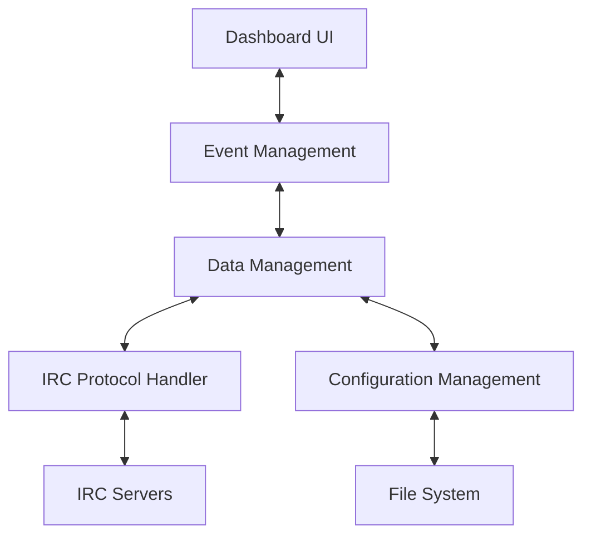

# squidowl/halloy

> Client IRC de bureau open source, simple et rapide, pour macOS, Windows et Linux.

## Le problème
Les clients IRC sont souvent anciens, peu configurables ou lourds, et gèrent mal les extensions IRCv3.

## Ce que ça fait vraiment
Application de bureau écrite en Rust avec la bibliothèque graphique Iced. Elle gère de nombreuses capacités IRCv3 (chathistory, multiline, read-marker, SASL 3.1, réactions, bouncer soju). L'architecture décrite sépare l'interface, la couche de données (config, historique, transferts de fichiers) et le protocole IRC.

## Comment c'est branché
Schéma d'après le diagramme fourni.

## Essayer
Le README ne donne pas de commande : il renvoie à la documentation d'installation, à Flathub et au Snap Store.

## Coût et pièges
Gratuit. Licence GPL-3.0 : copyleft si tu l'intègres. 270 issues ouvertes.

## Ce que ce n'est pas
Pas un outil de collaboration moderne type Slack : il parle IRC uniquement. La section « Why? » du README est vide.

## Alternatives
Aucune alternative nommée dans le README.

## Pour toi
À ignorer pour un profil data/IA : c'est un client de messagerie sans rapport avec ton travail, sauf si tu fréquentes déjà des canaux IRC.

