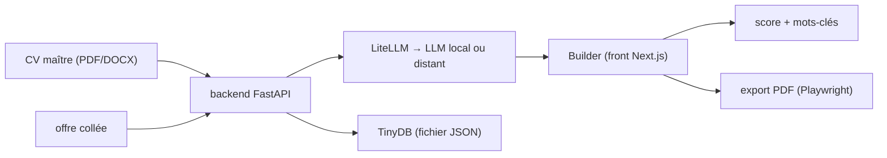

# srbhr/Resume-Matcher

> Local application that tailors a master resume to each job posting via an LLM.

## The problem
Rewriting your resume for each posting takes hours and produces inconsistent versions.
Without feedback on the expected keywords, you don't know what the posting really asks for.

## What it actually does
You upload a master resume (PDF or DOCX), paste a job posting, and the tool proposes a tailored resume, editable section by section.
It also generates a cover letter and interview preparation grounded in the saved resume.
Resume/posting match score with keyword highlighting and improvement suggestions.
PDF export via headless Chromium, four templates, interface and content in five languages.

## How it is wired


## Trying it
```bash
git clone https://github.com/srbhr/Resume-Matcher.git
cd Resume-Matcher
cd apps/backend
cp .env.example .env
uv sync
uv run app
docker run --name resume-matcher -p 3000:3000 -v resume-data:/app/backend/data ghcr.io/srbhr/resume-matcher:latest
```

## Cost and gotchas
Python 3.13+, Node 22+, uv; the AI provider is configured in `.env` and in the settings — key at your expense.
With Ollama in Docker, the URL must be `http://host.docker.internal:11434` and not `localhost`.

## What it is not
It is not a managed service: it is an application you run yourself, with a TinyDB database in a JSON file.
It is not an official ATS checker: the score is the tool's own, not a recruiter's.
The README devotes a large part to seeking sponsors, not to how it works.

## Alternatives
No alternative named in the README.

## For you
Unrelated to data/AI technical watch: a personal job-search tool, to be filed elsewhere.
