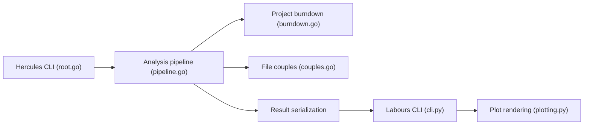

# src-d/hercules

> Go engine for analyzing Git history, with Python plots, for teams that want repository metrics.

## The problem
Understanding how code and a team evolve over thousands of commits requires heavy analyses that are costly to write yourself.

## What it actually does
`hercules` runs a graph of analyses over the whole history (branches and merges included) and outputs YAML or Protocol Buffers; `labours` (Python) plots the results: burndown of the project, files, people, overwrites matrix, code ownership, file/developer coupling (Swivel embeddings), structural hotspots, aligned commit series, comment sentiment (TensorFlow). Plugins and result merging are documented.

## How it is wired


## Trying it
```bash
pip3 install labours
hercules --burndown https://github.com/go-git/go-git | labours -m burndown-project --resample month
hercules --help
```

## Cost and gotchas
Free. "Memory" mode requires the repository to fit in RAM; burndown can exhaust memory (hibernation, `--first-parent`). Couples and sentiment require TensorFlow.

## What it is not
Not actively maintained: last push in February 2023. License present but not identified by GitHub: check before any use.

## Alternatives
- git-of-theseus: same burndown, but much slower according to the README.

## For you
Worth watching: original repository analyses, but a dormant project and an unclear license; test occasionally, do not integrate.
