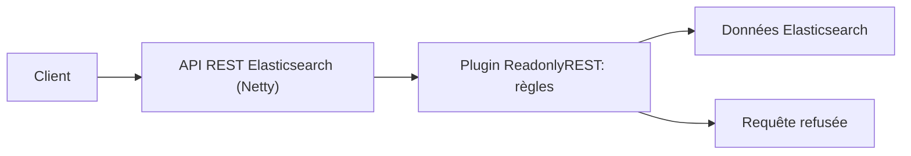

# sscarduzio/elasticsearch-readonlyrest-plugin

> Elasticsearch plugin that filters access to its REST API so it can be opened up without a proxy, blocking writes and deletions.

## The problem
Exposing Elasticsearch to clients without the risk of them modifying or deleting data, with no proxy in front.

## What it actually does
A filtering layer in pure Java inside Elasticsearch's Netty HTTP server, with access rules applied after request parsing. The SSL layer is a Netty transport handler. The README points to the website for the list of rules.

## How it is wired
Simplified diagram based on the sheet, no diagram provided.



## Trying it
```bash
# Aucune commande dans le README : voir la documentation officielle et le guide de développement.
```

## Cost and gotchas
Free according to the README, under GPL-3.0. A compatible Elasticsearch is required; its versions are not stated here.

## What it is not
Not a complete security solution: the README details neither authentication nor supported versions. The README gives no installation command.

## Alternatives
No alternative named; the README criticizes the Varnish, NGINX and HAProxy proxies.

## For you
Watch: useful if you expose an Elasticsearch to clients, but validate against the official documentation before any use.
