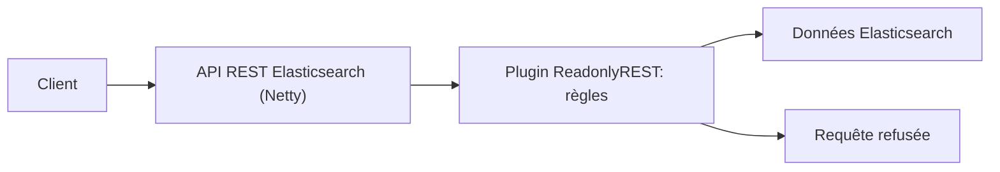

# sscarduzio/elasticsearch-readonlyrest-plugin

> Plugin Elasticsearch qui filtre l'accès à son API REST pour l'ouvrir sans proxy, en bloquant écritures et suppressions.

## Le problème
Exposer Elasticsearch à des clients sans risquer qu'ils modifient ou suppriment les données, sans proxy devant.

## Ce que ça fait vraiment
Une couche de filtrage en Java pur dans le serveur HTTP Netty d'Elasticsearch, avec règles d'accès appliquées après l'analyse des requêtes. La couche SSL est un gestionnaire de transport Netty. Le README renvoie au site pour la liste des règles.

## Comment c'est branché
Schéma simplifié d'après la fiche, sans diagramme fourni.



## Essayer
```bash
# Aucune commande dans le README : voir la documentation officielle et le guide de développement.
```

## Coût et pièges
Gratuit côté README, sous GPL-3.0. Il faut un Elasticsearch compatible, dont les versions ne sont pas indiquées ici.

## Ce que ce n'est pas
Pas une solution de sécurité complète : le README ne détaille ni l'authentification ni les versions prises en charge. Le README ne donne aucune commande d'installation.

## Alternatives
Aucune alternative nommée ; le README critique les proxys Varnish, NGINX et HAProxy.

## Pour toi
Surveiller : sert si tu exposes un Elasticsearch à des clients, mais à valider avec la documentation officielle avant tout usage.

