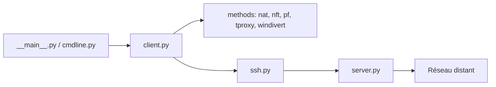

# sshuttle/sshuttle

> VPN-like transparent proxy over SSH, for reaching a remote network without being an admin.

## The problem
Reaching a remote network without a VPN, or with a painful one, means creating a port forward per host and per port.

## What it actually does
Locally captures IP traffic destined for chosen subnets and sends it through an SSH connection to a server that reinjects it into the remote network. Avoids TCP-over-TCP. The code offers interchangeable firewall methods: nat, nft, pf, ipfw, tproxy, windivert. Can run as a service.

## How it is wired

## Trying it
The README contains no command: it points to the installation documentation on readthedocs.

## Cost and gotchas
Free. Modifies local firewall rules, so elevated privileges are needed on the client side. License LGPL-2.1.

## What it is not
Not a full VPN: no end-to-end encryption beyond SSH, and it requires SSH access.

## Alternatives
No alternative cited in the README (OpenSSH and PermitTunnel are mentioned as options that were set aside).

## For you
Adopt: very handy for reaching an internal cluster or database over SSH without setting up a VPN.
