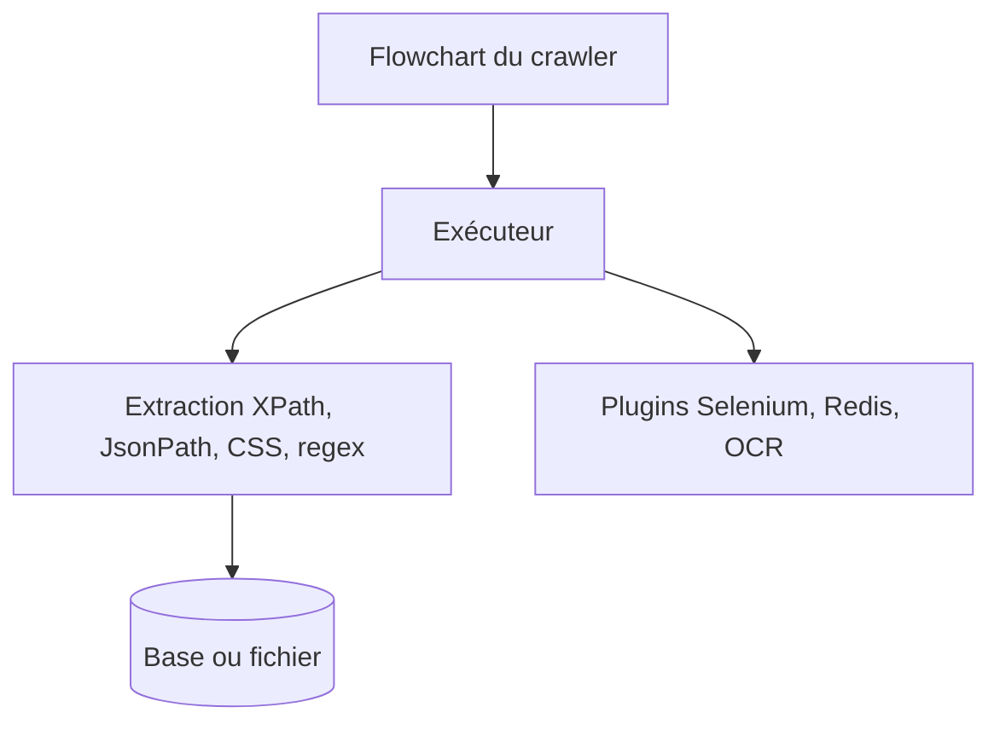

# ssssssss-team/spider-flow

> Crawling platform configured through a flow diagram, for developers who know how to set up extractions.

## The problem
Writing and maintaining crawlers in code for every site is time-consuming.

## What it actually does
Defines a crawler as a flowchart. Extracts with XPath, JsonPath, CSS selectors or regex; handles JSON, XML, binary, JS-rendered pages, proxies, cookies, saving to database or file, logs. Plugins: Selenium, Redis, OSS, MongoDB, IP proxies, OCR, e-mail.

## How it is wired
Architecture not documented in the provided README (in Chinese, no diagram).


## Trying it
No commands in the provided README.
```bash
# non documenté dans le README fourni
```

## Cost and gotchas
Free, MIT. Last push on 2023-06-14: project probably dormant. Deployment mode not specified.

## What it is not
Not an AI tool. The README recalls a legal-use clause: respect the sites' rules (robots).

## Alternatives
- spider-flow-vue: front-end interface by the same author.

## For you
Ignore: crawler dormant since 2023 with minimal documentation; a maintained tool is better.
