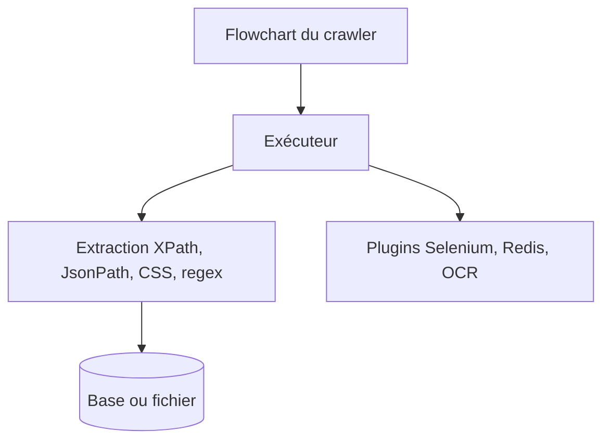

# ssssssss-team/spider-flow

> Plateforme de crawl configurable par diagramme de flux, pour développeurs sachant paramétrer des extractions.

## Le problème
Écrire et maintenir des crawlers en code pour chaque site est long.

## Ce que ça fait vraiment
Définit un crawler sous forme de flowchart. Extrait par XPath, JsonPath, sélecteurs CSS ou regex ; gère JSON, XML, binaire, pages rendues en JS, proxys, cookies, sauvegarde en base ou fichier, journaux. Plugins : Selenium, Redis, OSS, MongoDB, proxys IP, OCR, e-mail.

## Comment c'est branché
Architecture non documentée dans le README fourni (en chinois, sans diagramme).


## Essayer
Aucune commande dans le README fourni.
```bash
# non documenté dans le README fourni
```

## Coût et pièges
Gratuit, MIT. Dernier push le 2023-06-14 : projet probablement dormant. Mode de déploiement non précisé.

## Ce que ce n'est pas
Pas un outil d'IA. Le README rappelle une clause d'usage légal : respecter les règles des sites (robots).

## Alternatives
- spider-flow-vue : interface front du même auteur.

## Pour toi
Ignorer : crawler dormant depuis 2023 et documentation minimale, mieux vaut un outil entretenu.

