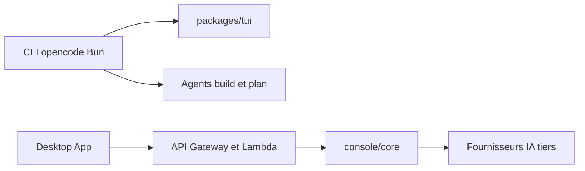

# sst/opencode

> A code agent for use in a terminal, vendor-agnostic, for developers who want to choose their own model.

## The problem
Code agents are often associated with a vendor and its publisher.

## What it actually does
The provided README is incomplete: it mainly covers installation and agents. Two integrated agents, activated with Tab: `build` (full access) and `plan` (read-only, requires confirmation before bash commands), plus a sub-agent `general`. Desktop application in beta. According to the code: a monorepo with CLI, TUI, web console, SDK, and serverless functions.

## How it is wired


## Trying it
```bash
curl -fsSL https://opencode.ai/install | bash
npm i -g opencode-ai@latest
brew install anomalyco/tap/opencode
```

## Cost and gotchas
The README does not mention keys: the architecture shows third-party AI providers, so it's your responsibility. The name "opencode" is trademarked: derivative projects must specify that they are not affiliated.

## What it is not
Not documented in this README: configuration, models, and pricing refer to the online documentation. Do not assume that any unmentioned function is available. License not declared.

## Alternatives
No alternative is specified in the README.

## For you
To be used for testing: a code agent from a vendor is tested with a single command; it verifies the license, which is not declared.
