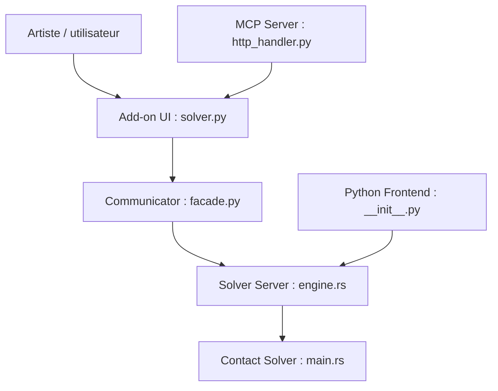

# st-tech/ppf-contact-solver

> Contact solver for physics simulations (cloth, solids, rods, sand), with a Blender add-on, a Python API and an MCP server.

## The problem
Cloth simulations produce interpenetrations that are hard to fix.

## What it actually does
Continuous collision detection and a cubic barrier: every successful step is guaranteed to be intersection-free, but the solver may crash or stall in extreme cases. Frontends: a Blender add-on (local or remote simulation) and JupyterLab in Python. CUDA, ROCm, Metal and CPU backends. An MCP server lets an LLM drive Blender.

## How it is wired


## Trying it
```bash
./ppf-contact-solver
docker run --rm -it --name ppf-contact-solver --gpus all -p 8080:8080 -p 9090:9090 -e WEB_PORT=8080 ghcr.io/st-tech/ppf-contact-solver-compiled:latest
```

## Cost and gotchas
A recent GPU is recommended; CPU and Metal are much slower. Docker is limited to x86_64 with NVIDIA. GPU rental is possible (AWS around $1/h, vast.ai under $0.5/h according to the README). Remember to delete the instances.

## What it is not
Not real-time, not differentiable, not the fastest: the README says so, and advises against production use. ROCm has never been tested on real hardware.

## Alternatives
No alternative named in the README (the FAQ compares itself to commercial products without naming them).

## For you
Worth watching: interesting for GPU simulation (synthetic data, 3D), but not differentiable, so useless for gradient-based learning.
