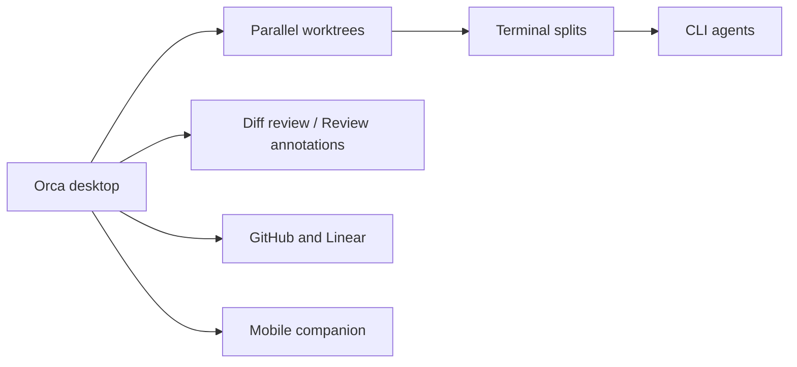

# stablyai/orca

> A desktop application that runs multiple code agents in parallel, each within its own Git worktree.

## The problem
Running Codex, Claude Code, or OpenCode simultaneously within the same repository will cause conflicts and make it difficult to track changes.

## What it actually does
Orca opens a separate workspace for each agent, with split terminals, an editor, and a diff review tool that sends changes back to the agent. It also integrates with GitHub and Linear, supports remote SSH worktrees, has a design mode (for sending HTML/CSS elements from a page to the agent), and offers a scriptable command-line interface. A companion mobile app allows users to monitor the agents. The README is primarily a list of features; detailed information can be found in the documentation.

## How it is wired


## Trying it
```bash
brew install --cask stablyai/orca/orca
yay -S stably-orca-bin
```

## Cost and gotchas
The app is free; agent subscriptions or licenses remain your responsibility. The mobile app's archive is located in the repository (cloud folder). More than 9,000 open cases.

## What it is not
Not an agent: it's an interface orchestrator. The slogan "100x builders" is not proven. "Computer Use" gives agents control over your desktop.

## Alternatives
- No alternative is specified in the README.

## For you
Things to watch out for: useful for comparing multiple agents on the same task in separate worktrees; measures the difference with a simple `git worktree` before adopting it.
