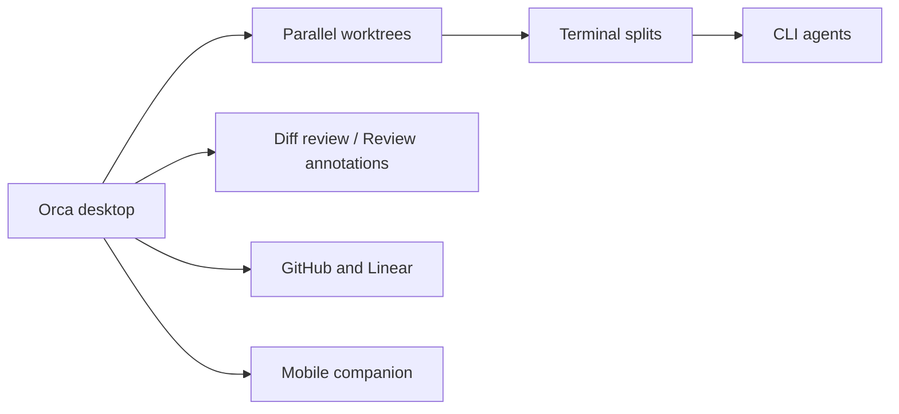

# stablyai/orca

> Application de bureau qui fait tourner plusieurs agents de code en parallèle, chacun dans son worktree git.

## Le problème
Lancer Codex, Claude Code ou OpenCode en parallèle sur un même dépôt provoque conflits et perte de suivi.

## Ce que ça fait vraiment
Orca ouvre chaque agent dans un worktree isolé, avec terminaux scindables, éditeur, revue de diffs annotables renvoyés à l'agent, intégration GitHub et Linear, worktrees SSH distants, mode design (envoi d'éléments HTML/CSS d'une page à l'agent) et CLI scriptable. Une app mobile compagnon permet de surveiller les agents. Le README est surtout une liste de fonctions ; le détail renvoie à la documentation.

## Comment c'est branché


## Essayer
```bash
brew install --cask stablyai/orca/orca
yay -S stably-orca-bin
```

## Coût et pièges
L'app est gratuite ; les abonnements ou clés des agents restent à ta charge. Le relais de l'app mobile est dans le dépôt (dossier cloud/). Plus de 9 000 issues ouvertes.

## Ce que ce n'est pas
Pas un agent : c'est un orchestrateur d'interface. Le slogan « 100x builders » n'est pas démontré. La « Computer Use » donne aux agents la main sur ton bureau.

## Alternatives
- Aucune alternative nommée dans le README.

## Pour toi
À surveiller : utile pour comparer plusieurs agents sur une même tâche dans des worktrees séparés ; mesure l'écart avec un simple `git worktree` avant de l'adopter.

