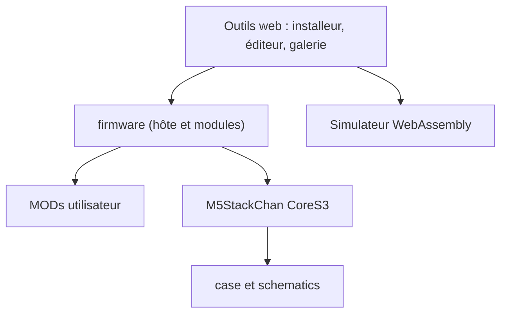

# stack-chan/stack-chan

> Small open-source desktop robot driven by JavaScript, built on M5Stack.

## The problem
Programming a small expressive robot normally requires assembling hardware, firmware and tools.

## What it actually does
Provides the firmware for the M5StackChan CoreS3, applications called MODs, browser tools (firmware installer, preferences over BLE, MOD gallery, Blockly editor, face editor, simulator, MediaPipe tracking), the case models and the schematics.

## How it is wired
Simplified diagram based on the sheet, no diagram provided.


## Trying it
```bash
# No shell command in the README: you flash the firmware from the web installer (Chrome or Edge, USB cable).
```

## Cost and gotchas
You have to buy the M5StackChan robot. Flashing this firmware replaces M5Stack's; restoring goes through M5Burner.

## What it is not
Not a turnkey AI robot: the repository provides firmware and tools, not an assistant.

## Alternatives
No alternative named in the README.

## For you
Ignore: hobby robotics project on a microcontroller, far from data / AI / MLOps work.
