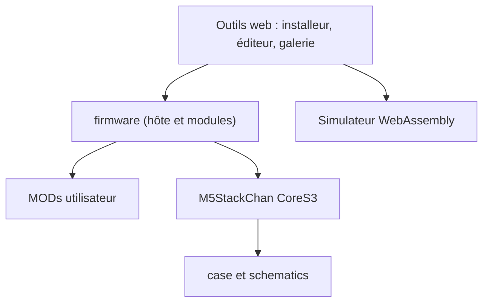

# stack-chan/stack-chan

> Petit robot de bureau open source piloté en JavaScript, construit sur M5Stack.

## Le problème
Programmer un petit robot expressif demande normalement d'assembler matériel, firmware et outils.

## Ce que ça fait vraiment
Fournit le firmware pour le M5StackChan CoreS3, des applications appelées MODs, des outils navigateur (installeur de firmware, préférences par BLE, galerie de MODs, éditeur Blockly, éditeur de visages, simulateur, suivi MediaPipe), les modèles de boîtier et les schémas.

## Comment c'est branché
Schéma simplifié d'après la fiche, sans diagramme fourni.


## Essayer
```bash
# Aucune commande shell dans le README : on flashe le firmware depuis l'installeur web (Chrome ou Edge, câble USB).
```

## Coût et pièges
Il faut acheter le robot M5StackChan. Flasher ce firmware remplace celui de M5Stack ; la restauration passe par M5Burner.

## Ce que ce n'est pas
Pas un robot d'IA clés en main : le dépôt fournit firmware et outils, pas un assistant.

## Alternatives
Aucune alternative nommée dans le README.

## Pour toi
À ignorer : projet de robotique de loisir sur microcontrôleur, loin d'un travail data / IA / MLOps.

