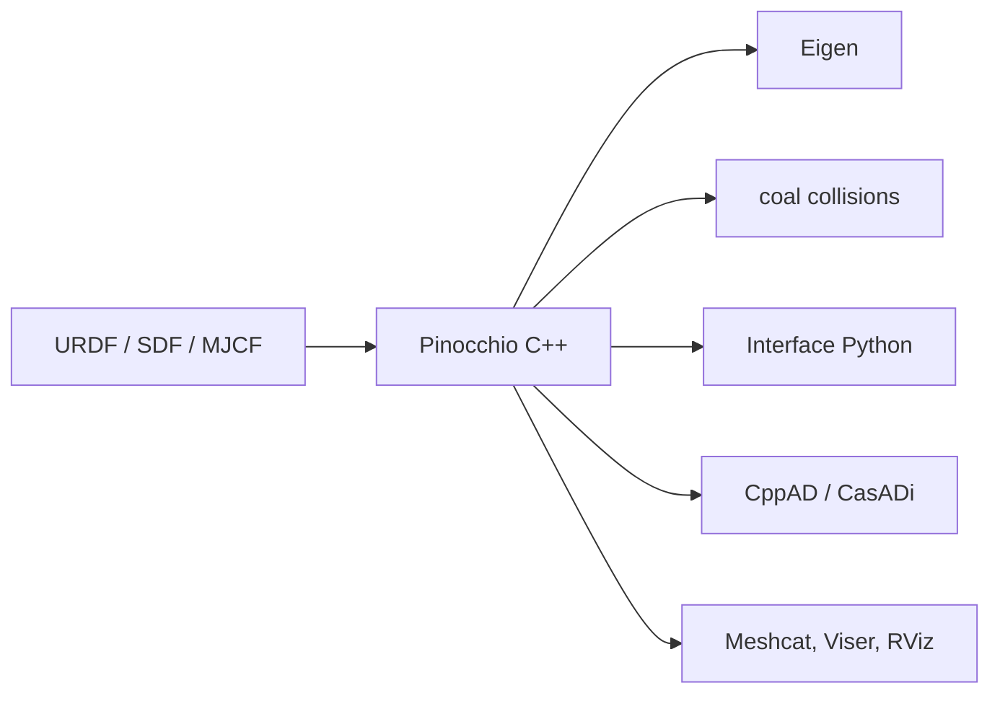

# stack-of-tasks/pinocchio

> C++ rigid-body dynamics library with analytical derivatives, for robotics and control researchers.

## The problem
Simulating and optimizing articulated robots requires fast dynamics algorithms, with the gradients needed for optimization and learning.

## What it actually does
Implements kinematics, forward and inverse dynamics, centroidal dynamics and their analytical derivatives, with handling of closed loops and frictional contacts. Reads the URDF, SDF, MJCF and SRDF formats. Builds on Eigen and coal, supports CppAD and CasADi, and offers a Python interface. Header-only, C++17 to 23. Developed by Inria's Willow team.

## How it is wired
Simplified diagram based on the write-up, no diagram provided.


## Trying it
```bash
conda install pinocchio -c conda-forge
pip install pin
docker run --rm -it ghcr.io/stack-of-tasks/pinocchio:devel
sudo apt install ros-$ROS_DISTRO-pinocchio
```
`pip install pin` is only available on Linux according to the README.

## Cost and gotchas
Free. C++ use requires Eigen and Boost; `pinocchio/fwd.hpp` must be included first. A real learning curve in multibody dynamics.

## What it is not
Not a full simulator nor a reinforcement learning engine: it is a computation building block on which Crocoddyl, Aligator or Jiminy rely.

## Alternatives
The README cites projects that build on it: Crocoddyl, Aligator, TSID, Jiminy, Simple.

## For you
Worth watching: a solid reference if you do control or learning in robotics with gradients, irrelevant for a classic data pipeline.
