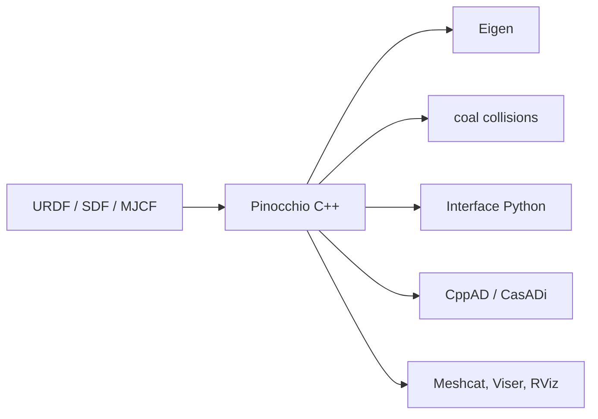

# stack-of-tasks/pinocchio

> Bibliothèque C++ de dynamique de corps rigides avec dérivées analytiques, pour chercheurs en robotique et contrôle.

## Le problème
Simuler et optimiser des robots articulés demande des algorithmes de dynamique rapides, avec les gradients pour l'optimisation et l'apprentissage.

## Ce que ça fait vraiment
Implémente cinématique, dynamique directe et inverse, dynamique centroïdale et leurs dérivées analytiques, avec gestion des boucles fermées et des contacts frictionnels. Lit les formats URDF, SDF, MJCF et SRDF. S'appuie sur Eigen et coal, supporte CppAD et CasADi, et propose une interface Python. En-têtes seuls en C++17 à 23. Développée par l'équipe Willow d'Inria.

## Comment c'est branché
Schéma simplifié d'après la fiche, sans diagramme fourni.


## Essayer
```bash
conda install pinocchio -c conda-forge
pip install pin
docker run --rm -it ghcr.io/stack-of-tasks/pinocchio:devel
sudo apt install ros-$ROS_DISTRO-pinocchio
```
Le `pip install pin` n'est disponible que sous Linux d'après le README.

## Coût et pièges
Gratuit. L'usage C++ suppose Eigen et Boost ; il faut inclure `pinocchio/fwd.hpp` en premier. Courbe d'apprentissage réelle en dynamique multicorps.

## Ce que ce n'est pas
Pas un simulateur complet ni un moteur d'apprentissage par renforcement : c'est une brique de calcul sur laquelle s'appuient Crocoddyl, Aligator ou Jiminy.

## Alternatives
Le README cite des projets qui s'appuient dessus : Crocoddyl, Aligator, TSID, Jiminy, Simple.

## Pour toi
À surveiller : référence solide si tu fais du contrôle ou de l'apprentissage en robotique avec gradients, sans objet pour une chaîne data classique.

