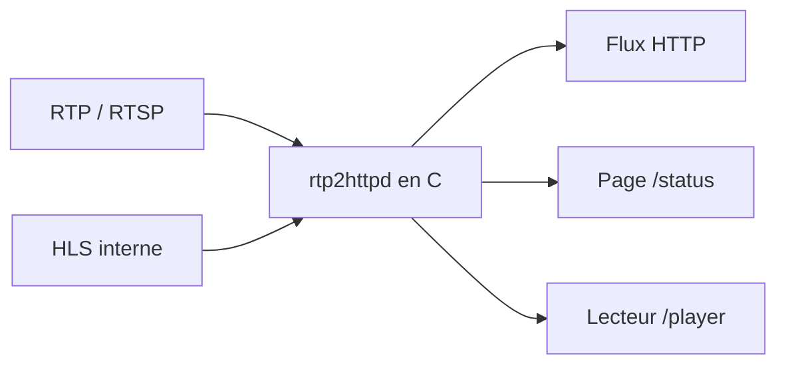

# stackia/rtp2httpd

> Multicast RTP/RTSP IPTV to HTTP conversion server, optimized for Chinese IPTV networks.

## The problem
An operator's multicast IPTV streams cannot be played directly outside the local network or on an ordinary player.

## What it actually does
Converts RTP/UDP multicast and RTSP to HTTP, proxies HLS streams, generates M3U playlists, supports operator FCC (fast channel change), reordering correction and Reed-Solomon FEC. Web status page, built-in web player with EPG and catch-up. Written in C, 509 KB (x86_64), multi-process epoll.

## How it is wired


## Trying it
```bash
# Aucune commande dans le README ; installation et guide OpenWrt dans la documentation en ligne.
```
Status page: `http://<host>/status`, player: `/player`.

## Cost and gotchas
Free. Assumes an operator IPTV subscription and network; the network documentation (DHCP, multicast) is a prerequisite. README in Chinese.

## What it is not
Not a transcoder: no decoding. GPL-2.0: modifications must be published.

## Alternatives
udpxy and msd_lite, of which it presents itself as a compatible replacement.

## For you
Ignore: IPTV and home-network niche, unrelated to data/AI/MLOps.
