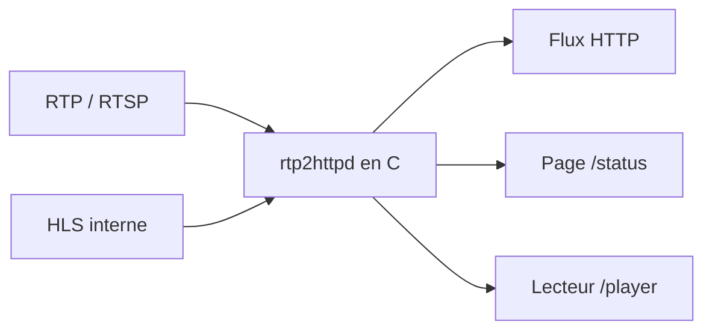

# stackia/rtp2httpd

> Serveur de conversion IPTV multicast RTP/RTSP vers HTTP, optimisé pour les réseaux IPTV chinois.

## Le problème
Les flux IPTV multicast d'un opérateur ne se lisent pas directement hors du réseau local ou sur un lecteur ordinaire.

## Ce que ça fait vraiment
Convertit RTP/UDP multicast et RTSP en HTTP, proxifie des flux HLS, génère des playlists M3U, supporte le FCC opérateur (changement de chaîne rapide), la correction d'ordre et le FEC Reed-Solomon. Page de statut web, lecteur web intégré avec EPG et rattrapage. Écrit en C, 509 Ko (x86_64), epoll multi-processus.

## Comment c'est branché


## Essayer
```bash
# Aucune commande dans le README ; installation et guide OpenWrt dans la documentation en ligne.
```
Page de statut : `http://<hôte>/status`, lecteur : `/player`.

## Coût et pièges
Gratuit. Suppose un abonnement et un réseau IPTV d'opérateur ; la doc réseau (DHCP, multicast) est un prérequis. README en chinois.

## Ce que ce n'est pas
Pas un transcodeur : pas de décodage. GPL-2.0 : modifications à publier.

## Alternatives
udpxy et msd_lite, dont il se présente comme remplaçant compatible.

## Pour toi
À ignorer : niche IPTV et réseaux domestiques, sans lien avec data/IA/MLOps.

