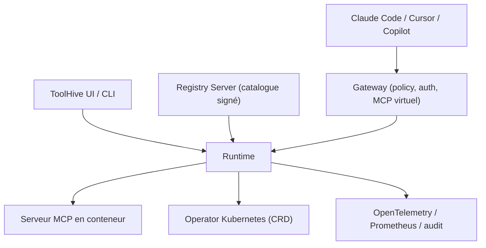

# stacklok/toolhive

> A platform that runs any MCP server in an isolated container, with policy and audit.

## The problem
MCP servers run on the developer's machine with their credentials, without isolation, without a log and without visibility for the security team.

## What it actually does
Three components. The **Gateway** defines dedicated endpoints, orchestrates several tools into one virtual MCP with a deterministic workflow engine, applies policies, authentication (OIDC/OAuth for SSO) and audit, and filters tools and their descriptions to reduce token consumption. The **Registry Server** curates a catalog of trusted servers, integrates with the official MCP registry, verifies provenance and signs servers. The **Runtime** deploys locally via Docker or Podman, or in a cluster via a Kubernetes operator with CRDs, OpenTelemetry and Prometheus. Two interfaces: a desktop UI and a CLI.

## How it is wired

## Trying it
No command is given in the README: it points to the Downloads pages and the quickstarts (desktop app, CLI, Kubernetes operator).

## Cost and gotchas
The core is open source. Stacklok sells an Enterprise edition with additional capabilities, and the README explicitly pushes toward that scale-up path — the open source / paid boundary is to be checked before industrializing. Each MCP server runs in a container: Docker or Podman required locally, a cluster otherwise.

## What it is not
It is not an MCP server: it is what runs and governs them. It is not a SaaS — that is precisely the argument put forward against hosted solutions. The announced token reduction "up to 85%" comes from tool filtering and semantic search, and depends entirely on your catalog.

## Alternatives
- The official MCP registry, with which ToolHive integrates rather than replacing it.
- SaaS MCP solutions, ruled out here for compliance reasons.

## For you
The right level of abstraction as soon as several people use MCPs in the same company.
