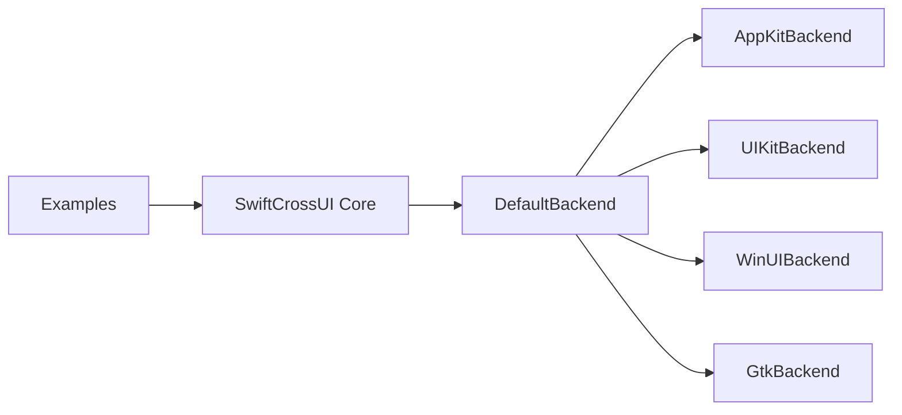

# stackotter/swift-cross-ui

> SwiftUI-inspired Swift framework for building native cross-platform applications.

## The problem
SwiftUI is limited to Apple platforms; targeting Linux, Windows or Android forces you to rewrite the interface.

## What it actually does
Takes part of the SwiftUI API (App, Scene, View, `@State`) and adapts it through backends: AppKit (macOS), UIKit (iOS/tvOS), WinUI (Windows), Gtk 4 and Gtk3 (Linux, also macOS/Windows), Android. `DefaultBackend` chooses based on the OS. The README admits the documentation is still being written; 217 open issues.

## How it is wired


## Trying it
```bash
git clone https://github.com/moreSwift/swift-cross-ui
cd swift-cross-ui/Examples
swift-bundler run CounterExample
```

## Cost and gotchas
Free; Swift 5.10+ and Swift Bundler for the examples. Gtk 4 required for the Linux backend. Compatibility with SwiftUI is not complete.

## What it is not
Not a copy of SwiftUI: the README says it does not aim for parity.

## Alternatives
No alternative named in the README.

## For you
Ignore: native UI in Swift, unrelated to data, AI or MLOps tasks.
