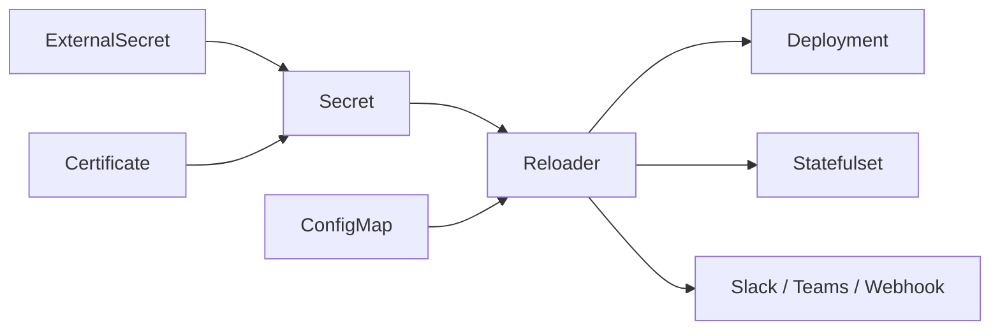

# stakater/Reloader

> Kubernetes controller that restarts workloads when a ConfigMap or Secret changes.

## The problem
Kubernetes restarts nothing when a referenced `Secret` or `ConfigMap` is updated: pods keep the old configuration, stale credentials included.

## What it actually does
Watches `Secrets`, `ConfigMaps` and, optionally, secrets mounted via CSI (`SecretProviderClassPodStatus`), and triggers a rollout on Deployment, StatefulSet, DaemonSet, DeploymentConfig, ArgoRollout or CronJob. Triggering is driven by annotations: `auto`, named `reload`, `search`+`match` mode, `ignore`, timed pause. Two strategies: `env-vars` (default) or `annotations`, preferred in GitOps to avoid drift. Optional alerts to Slack, Teams, Google Chat or a webhook.

## How it is wired


## Trying it
```bash
helm repo add stakater https://stakater.github.io/stakater-charts
helm repo update
helm install reloader stakater/reloader
kubectl apply -f https://raw.githubusercontent.com/stakater/Reloader/master/deployments/kubernetes/reloader.yaml
```

## Cost and gotchas
The OSS version is free; signed images with SBOM, SLA and artifact provenance are reserved for **Reloader Enterprise** (sales contact). Kubernetes ≥ 1.19. Only one resource type can be ignored at a time: ignoring `configmaps` **and** `secrets` causes an error.

## What it is not
Not a secrets manager: it reacts to changes, it neither stores nor rotates them. On the CSI side, it reacts to the driver's status, not to external vaults. License not declared in the README.

## Alternatives
No alternative repo is named in the README.

## For you
The small controller that prevents "the key rotated but the pod doesn't know" incidents.
