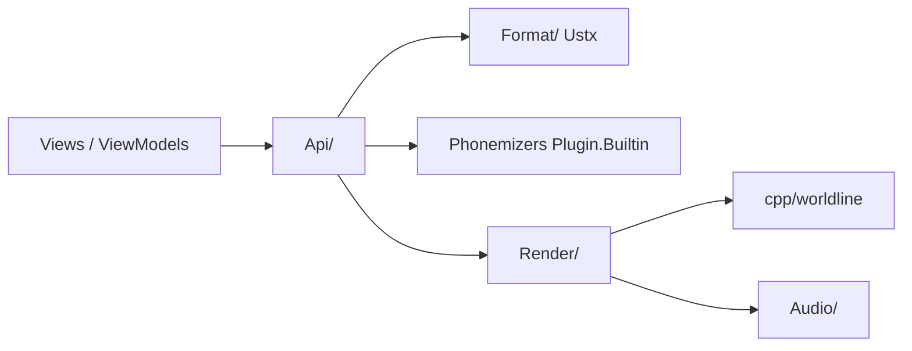

# stakira/OpenUtau

> Free, cross-platform singing voice editor for the UTAU community.

## The problem
Composing UTAU vocal tracks without the constraints of the original tool (system locale, dated interface).

## What it actually does
A MIDI editor with a vibrato editor, multilingual phonemizers, a built-in WORLDLINE-R resampler, pre-rendering, VSQX import, and support for ENUNU AI singers. According to the code: Avalonia/MVVM interface, .NET engine, native C++ DSP (Bazel), plugins loaded by reflection, Python scripts for the G2P models.

## How it is wired

## Trying it
No command documented in the README: read the "Getting-Started" wiki pages.

## Cost and gotchas
Free; Windows, macOS, Linux. Does not replace a digital audio workstation.

## What it is not
Neither an exact UTAU clone, nor compatible with Vocaloid (apart from limited features).

## Alternatives
No alternative named in the README.

## For you
Ignore for a data/AI profile, unless you are interested in voice synthesis (DiffSinger and ENUNU are plugged in).
