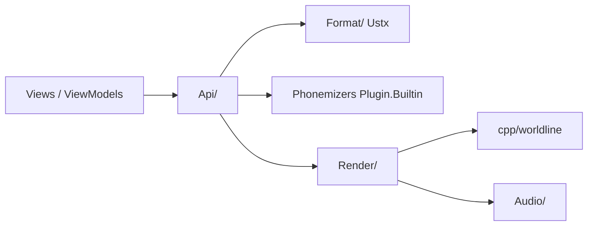

# stakira/OpenUtau

> Éditeur libre de voix chantées pour la communauté UTAU, multiplateforme.

## Le problème
Composer des pistes vocales UTAU sans les contraintes de l'outil d'origine (locale système, interface vieillie).

## Ce que ça fait vraiment
Éditeur MIDI avec éditeur de vibrato, phonémiseurs multilingues, rééchantillonneur WORLDLINE-R intégré, pré-rendu, import VSQX, support de chanteurs IA ENUNU. D'après le code : interface Avalonia/MVVM, moteur .NET, DSP natif C++ (Bazel), plugins chargés par réflexion, scripts Python pour les modèles G2P.

## Comment c'est branché

## Essayer
Aucune commande documentée dans le README : lire les pages wiki « Getting-Started ».

## Coût et pièges
Gratuit ; Windows, macOS, Linux. Ne remplace pas une station audionumérique.

## Ce que ce n'est pas
Ni un clone exact d'UTAU, ni compatible Vocaloid (sauf fonctions limitées).

## Alternatives
Aucune alternative nommée dans le README.

## Pour toi
À ignorer pour un profil data/IA, sauf intérêt pour la synthèse vocale (DiffSinger et ENUNU y sont branchés).

