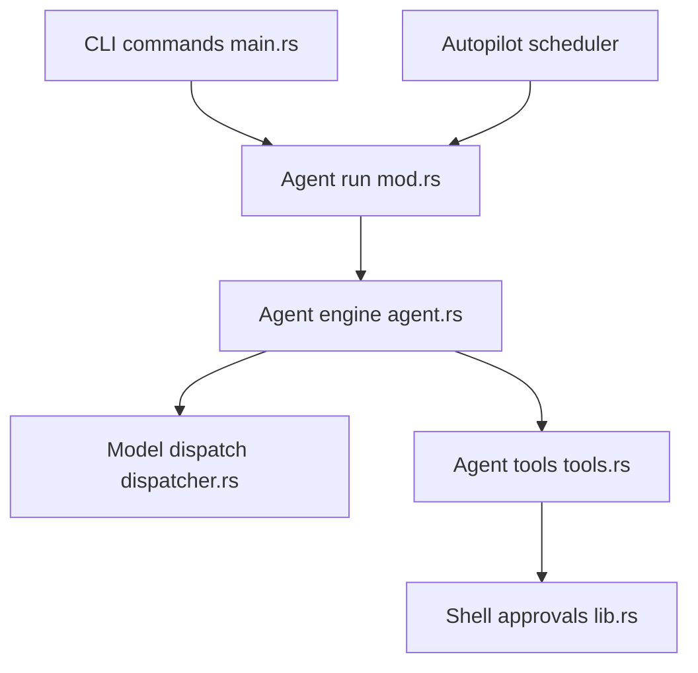

# stakpak/agent

> An open source DevOps agent that runs continuously on your machines and only bothers you when needed.

## The problem
Entrusting production to an AI agent is risky: one mistake and everything goes down. Secrets and destructive actions need safeguards.

## What it actually does
A CLI and a terminal interface launch an agent that queries a model and uses tools (files, commands, MCP). Secret substitution hides credentials from the model, network guardrails (Warden) block destructive operations, and autopilot mode schedules runs and notifies through Slack, Telegram or Discord. It indexes Terraform, Kubernetes, Dockerfile and GitHub Actions.

## How it is wired
Diagram taken from the code, simplified.



## Trying it
```bash
curl -sSL https://stakpak.dev/install.sh | sh
stakpak init
stakpak autopilot up
stakpak autopilot doctor
```

## Cost and gotchas
You need a Stakpak key (no credit card) or your own Anthropic, OpenAI or Gemini key, or a local OpenAI-compatible endpoint. Autopilot requires Docker and about 2 GB of RAM.

## What it is not
Not risk-free for all that: disabling secret redaction or mTLS is possible but discouraged. Remote MCP tools require an API key.

## Alternatives
No alternative named in the README.

## For you
Worth watching: secret substitution and network guardrails address a real MLOps need, but test it first on a disposable environment before giving it anything real.
