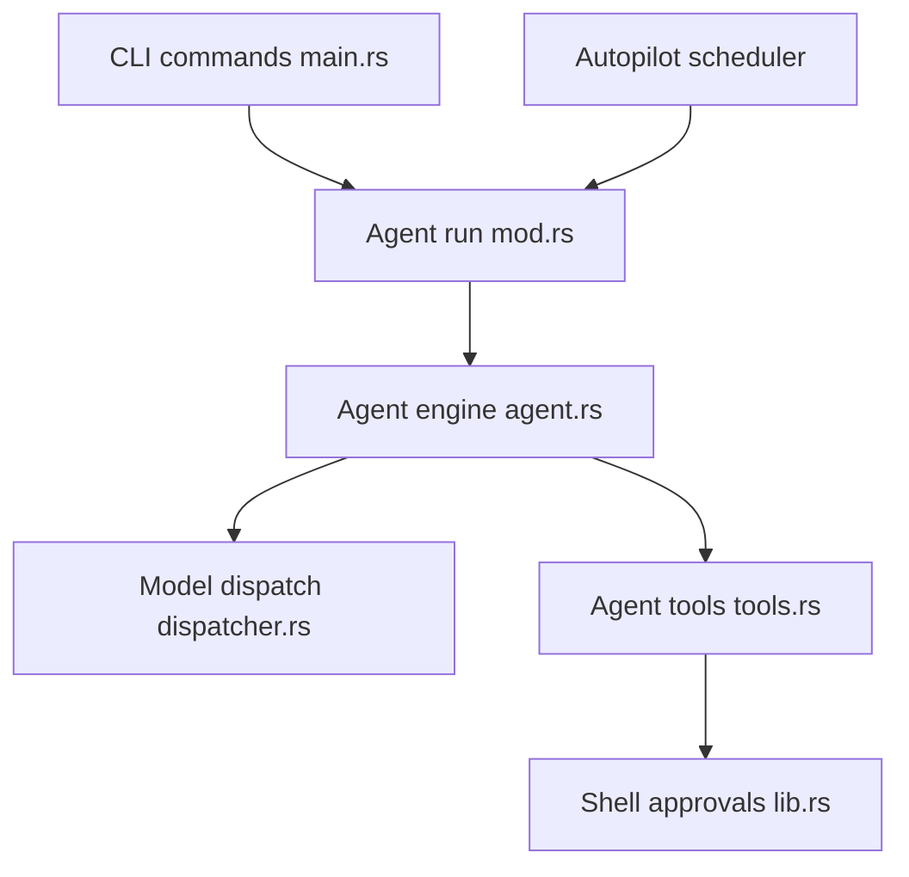

# stakpak/agent

> Un agent DevOps open source qui tourne en continu sur tes machines et ne te sollicite qu'au besoin.

## Le problème
Confier la production à un agent d'IA est risqué : une erreur, et tout tombe. Les secrets et les actions destructrices demandent des garde-fous.

## Ce que ça fait vraiment
Une CLI et une interface terminal lancent un agent qui consulte un modèle et utilise des outils (fichiers, commandes, MCP). La substitution de secrets cache les identifiants au modèle, des garde-fous réseau (Warden) bloquent les opérations destructrices, et le mode autopilot planifie des exécutions et notifie via Slack, Telegram ou Discord. Il indexe Terraform, Kubernetes, Dockerfile et GitHub Actions.

## Comment c'est branché
Diagramme tiré du code, simplifié.



## Essayer
```bash
curl -sSL https://stakpak.dev/install.sh | sh
stakpak init
stakpak autopilot up
stakpak autopilot doctor
```

## Coût et pièges
Il faut une clé Stakpak (sans carte bancaire) ou ta propre clé Anthropic, OpenAI ou Gemini, ou un endpoint local compatible OpenAI. L'autopilot demande Docker et environ 2 Go de RAM.

## Ce que ce n'est pas
Pas sans risque pour autant : désactiver la rédaction des secrets ou le mTLS est possible mais déconseillé. Les outils MCP distants exigent une clé d'API.

## Alternatives
Aucune alternative nommée dans le README.

## Pour toi
À surveiller : la substitution de secrets et les garde-fous réseau répondent à un vrai besoin MLOps, mais teste-le d'abord sur un environnement jetable avant de lui donner du réel.

