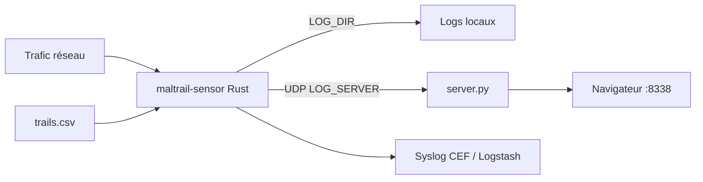

# stamparm/maltrail

> Defensive network traffic detector that spots exchanges with known malicious infrastructure, for security teams.

## The problem
Without indicator-based monitoring, a machine contacting a malware domain or IP goes unnoticed in ordinary network traffic.

## What it actually does
A sensor (Rust, libpcap) compares observed domains, URLs, IPs, `IP:port` and User-Agents against "trails" (indicators from static files, 42 public feeds and the operator's own lists). It adds a few heuristics (scans, DGA, suspicious downloads). Each detection becomes an event written locally, sent to a Python server (web interface, API), to syslog CEF or to JSON Logstash.

## How it is wired


## Trying it
```bash
sh install.sh --dry-run
sh install.sh --role sensor
sensor/target/release/maltrail-sensor -T
python3 server.py --detect-test
```

## Cost and gotchas
Free. The dashboard listens on `0.0.0.0` by default with `admin` / `changeme!`: change `USERS` and `HTTP_ADDRESS` before any exposure. The sensor needs `CAP_NET_RAW`/`CAP_NET_ADMIN`, and logs are neither rotated nor purged.

## What it is not
Neither an EDR nor an IPS: it detects, it does not block. It does not replace endpoint telemetry. Detection depends on the freshness of the trails, whose static part is a separate repository under a distinct license. Logs contain IPs, sometimes personal data.

## Alternatives
No alternative named in the README (only integrations: Wazuh, Splunk, OPNsense, pfBlockerNG).

## For you
Adopt it if you have a network to monitor: an old, MIT-licensed, active project that installs with one command; without a network to observe, it has no use.
