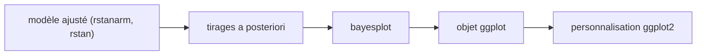

# stan-dev/bayesplot

> R package of plots for diagnosing Bayesian models fitted by MCMC, for statisticians and data scientists.

## The problem
After a Bayesian fit, judging chain convergence and prediction quality takes a lot of repetitive plotting code.

## What it actually does
Provides functions that produce ggplot objects: posterior distributions, MCMC diagnostics, prior and posterior predictive checks. The plots can then be customized with ggplot2. It also serves as a common foundation for other Bayesian packages, notably those built on Stan.

## How it is wired
Simplified diagram based on the sheet, no diagram provided.



## Trying it
```r
install.packages("bayesplot")
library("bayesplot")
library("rstanarm")
fit <- stan_glm(mpg ~ ., data = mtcars)
posterior <- as.matrix(fit)
mcmc_areas(posterior, pars = c("cyl", "drat", "am", "wt"), prob = 0.8)
```

## Cost and gotchas
Free. Requires R, and an already fitted model (rstanarm or rstan for example). The license is GPL-3.0: copyleft. The README asks you to cite papers depending on the plot used.

## What it is not
Not a model-fitting tool: it only plots existing results. It is not Python.

## Alternatives
No alternative named in the README.

## For you
Worth watching: essential if you do Bayesian modeling in R and Stan, of no interest for a Python stack.
