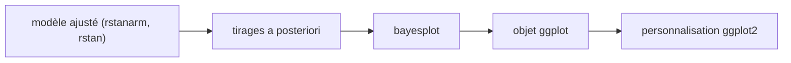

# stan-dev/bayesplot

> Paquet R de graphiques pour diagnostiquer les modèles bayésiens ajustés par MCMC, pour statisticiens et data scientists.

## Le problème
Après un ajustement bayésien, juger la convergence des chaînes et la qualité des prédictions demande beaucoup de code de tracé répétitif.

## Ce que ça fait vraiment
Fournit des fonctions qui produisent des objets ggplot : distributions a posteriori, diagnostics MCMC, vérifications prédictives a priori et a posteriori. Les graphiques se personnalisent ensuite avec ggplot2. Il sert aussi de socle commun aux autres paquets bayésiens, notamment ceux fondés sur Stan.

## Comment c'est branché
Schéma simplifié d'après la fiche, sans diagramme fourni.



## Essayer
```r
install.packages("bayesplot")
library("bayesplot")
library("rstanarm")
fit <- stan_glm(mpg ~ ., data = mtcars)
posterior <- as.matrix(fit)
mcmc_areas(posterior, pars = c("cyl", "drat", "am", "wt"), prob = 0.8)
```

## Coût et pièges
Gratuit. Il faut R, et un modèle déjà ajusté (rstanarm ou rstan par exemple). La licence est GPL-3.0 : copyleft. Le README demande de citer des articles selon le graphique employé.

## Ce que ce n'est pas
Ce n'est pas un outil d'ajustement de modèles : il trace seulement des résultats existants. Ce n'est pas du Python.

## Alternatives
Aucune alternative nommée dans le README.

## Pour toi
Surveiller : indispensable si tu fais de la modélisation bayésienne sous R et Stan, sans intérêt pour une pile Python.

