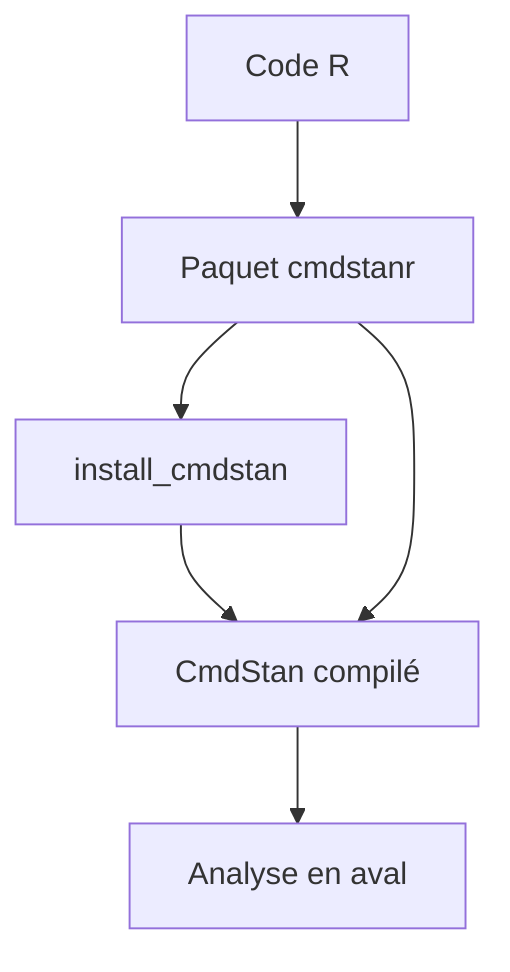

# stan-dev/cmdstanr

> Lightweight R interface to Stan, for statisticians doing Bayesian inference.

## The problem
Calling Stan from R by linking C++ directly into the R code is fragile and tracks Stan versions poorly.

## What it actually does
CmdStanR calls the compiled CmdStan executables from R, with no C++ code in the package. It runs Stan's algorithms and leaves the analysis to other modules. You need to install CmdStan with `install_cmdstan()` and have a C++ toolchain.

## How it is wired
Simplified diagram based on the sheet, no diagram provided.



## Trying it
```r
install.packages("cmdstanr", repos = c('https://stan-dev.r-universe.dev', getOption("repos")))
remotes::install_github("stan-dev/cmdstanr@v1.0")
```

## Cost and gotchas
Free. You need CmdStan and a C++ compiler; the full vignettes are not installed. The GitHub version is the pre-release of 1.0.

## What it is not
Not a computation engine: it drives Stan. It does not replace CmdStanPy for Python. The README mentions a BSD-3 license, but GitHub did not identify the file.

## Alternatives
CmdStanPy: the Python equivalent, according to the README.

## For you
Worth watching: useful if your team does Bayesian modeling in R; otherwise, CmdStanPy is closer to a Python profile.
