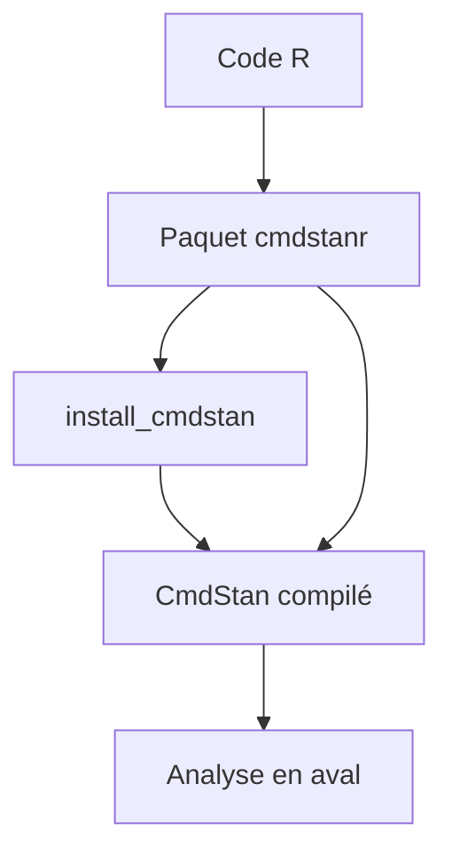

# stan-dev/cmdstanr

> Interface R légère vers Stan, pour statisticiens qui font de l'inférence bayésienne.

## Le problème
Appeler Stan depuis R sans lier du C++ directement au code R est fragile et suit mal les versions de Stan.

## Ce que ça fait vraiment
CmdStanR appelle les exécutables compilés de CmdStan depuis R, sans code C++ dans le paquet. Il lance les algorithmes de Stan et laisse l'analyse à d'autres modules. Il faut installer CmdStan avec `install_cmdstan()` et disposer d'une chaîne de compilation C++.

## Comment c'est branché
Schéma simplifié d'après la fiche, sans diagramme fourni.



## Essayer
```r
install.packages("cmdstanr", repos = c('https://stan-dev.r-universe.dev', getOption("repos")))
remotes::install_github("stan-dev/cmdstanr@v1.0")
```

## Coût et pièges
Gratuit. Il faut CmdStan et un compilateur C++ ; les vignettes complètes ne sont pas installées. La version GitHub est la préversion de la 1.0.

## Ce que ce n'est pas
Pas un moteur de calcul : il pilote Stan. Il ne remplace pas CmdStanPy pour Python. Le README parle d'une licence BSD-3, mais GitHub n'a pas identifié le fichier.

## Alternatives
CmdStanPy : l'équivalent pour Python, d'après le README.

## Pour toi
À surveiller : utile si ton équipe fait de la modélisation bayésienne sous R ; sinon, CmdStanPy est plus proche d'un profil Python.

