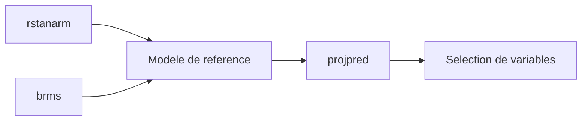

# stan-dev/projpred

> R package for variable selection by projection predictive inference, from rstanarm or brms models.

## The problem
Choosing which variables to keep in a Bayesian regression model without overfitting.

## What it actually does
Takes a reference model (rstanarm, brms or custom) and applies projection predictive variable selection for various types of regression. Details of the supported models, functions and examples are in the vignettes and the documentation, not in the README.

## How it is wired
Simplified diagram based on the sheet, no diagram provided.



## Trying it
```r
install.packages("projpred")
devtools::install_github("stan-dev/projpred", build_vignettes = TRUE)
```

## Cost and gotchas
Free. Requires R, not Python; this requirement is not in the prerequisites list. An rstanarm or brms model usually has to be fitted first, so Stan must be installed.

## What it is not
Not a generic variable selection library: it assumes a Bayesian reference model. The license is not recognized by GitHub.

## Alternatives
- rstanarm and brms: the tools that provide the reference model, not replacements.

## For you
Watch: useful if you do Bayesian modeling in R, irrelevant otherwise; check the license before commercial use.
