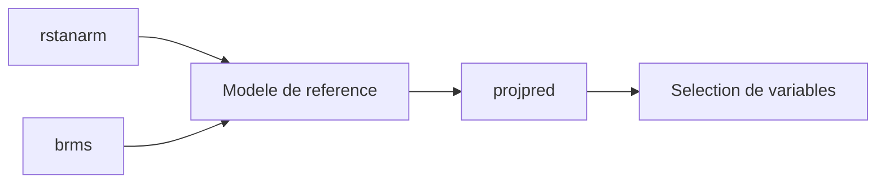

# stan-dev/projpred

> Package R pour la sélection de variables par projection prédictive, à partir de modèles rstanarm ou brms.

## Le problème
Choisir quelles variables garder dans un modèle de régression bayésien sans surajuster.

## Ce que ça fait vraiment
Prend un modèle de référence (rstanarm, brms ou personnalisé) et applique la sélection de variables par projection prédictive pour divers types de régression. Les détails des modèles pris en charge, des fonctions et des exemples sont dans les vignettes et la documentation, pas dans le README.

## Comment c'est branché
Schéma simplifié d'après la fiche, sans diagramme fourni.



## Essayer
```r
install.packages("projpred")
devtools::install_github("stan-dev/projpred", build_vignettes = TRUE)
```

## Coût et pièges
Gratuit. Nécessite R, pas Python ; ce besoin n'entre pas dans la liste des prérequis. Un modèle rstanarm ou brms est le plus souvent à ajuster d'abord, donc Stan installé.

## Ce que ce n'est pas
Pas une bibliothèque de sélection de variables générique : elle suppose un modèle bayésien de référence. La licence n'est pas reconnue par GitHub.

## Alternatives
- rstanarm et brms : les outils qui fournissent le modèle de référence, pas des remplaçants.

## Pour toi
Surveiller : utile si tu fais de la modélisation bayésienne sous R, sans objet autrement ; vérifie la licence avant un usage commercial.

