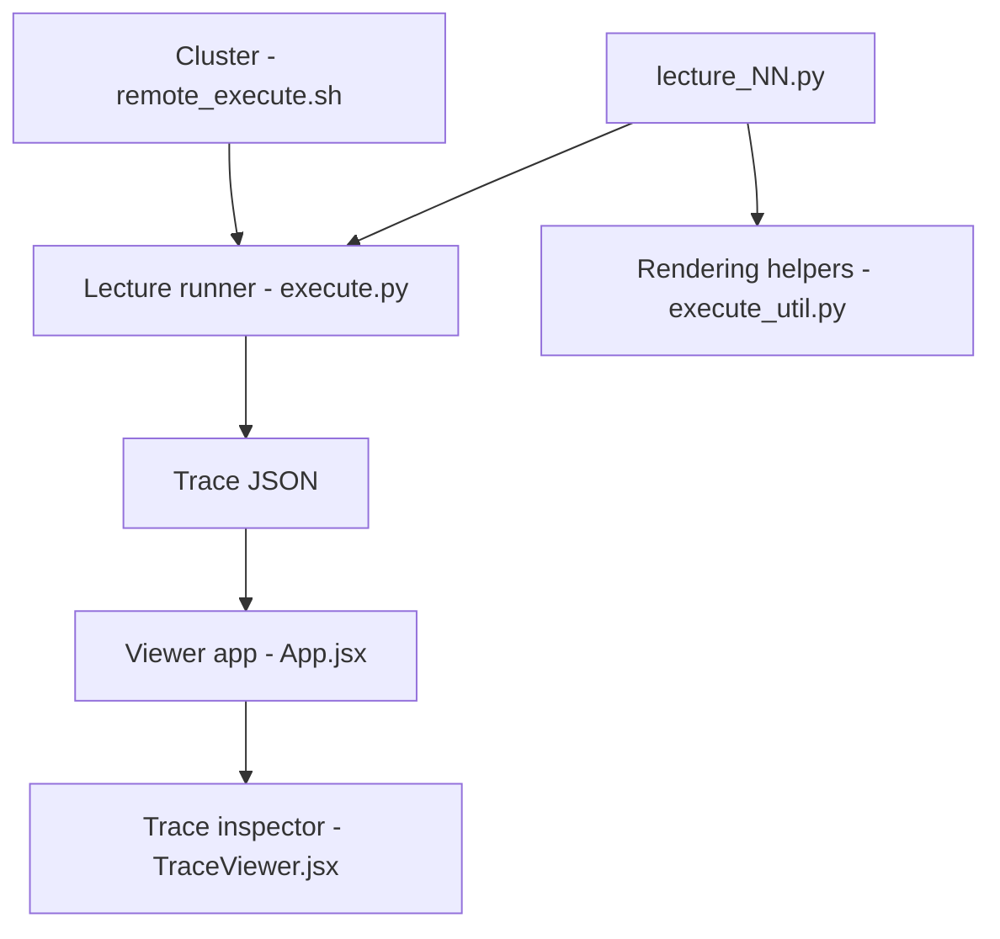

# stanford-cs336/spring2025-lectures

> Materials for the Stanford CS336 course "Language modeling from scratch": executable lectures in Python and PDFs.

## The problem
Following a course on building language models with code that runs and can be inspected, not just slides.

## What it actually does
Executable lectures are `lecture_*.py` files; `execute.py` generates a JSON trace from them (`var/traces/`) and caches the images. A React (Vite) viewer displays the trace. Non-executable lectures are PDFs in `nonexecutable/`. The graph cites tokens, model primitives, GPU kernels and other topics depending on the files.

## How it is wired


## Trying it
```bash
python execute.py -m lecture_01
./remote_execute.sh lecture_01
npm create vite@latest trace-viewer -- --template react
npm run dev
```

## Cost and gotchas
Free. The README is short: the Python environment and dependencies are not described, and the slurm cluster part is "incomplete" by the authors' own admission. Last push on 2026-03-31, repo created the same day.

## What it is not
It is not a library or a training framework: it is course material. The PDFs do not execute.

## Alternatives
No alternative named in the README.

## For you
Worth watching: relevant for learning LLMs from scratch, but with no installation instructions, so test it before relying on it.
