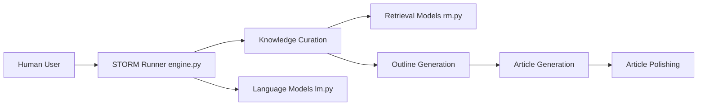

# stanford-oval/storm

> Stanford Python library that writes sourced Wikipedia-style articles via web search and LLMs.

## The problem
Getting an LLM to write a long sourced article yields superficial text: it does not know which questions to ask.

## What it actually does
STORM: perspective-guided research and simulated writer/expert conversations, then outline, cited article and polishing.
Co-STORM: collaborative discourse with LLM experts, a moderator and a human, shared mind map.
Models and embeddings via litellm; retrievers You, Bing, Serper, Brave, SearXNG, DuckDuckGo, Tavily, VectorRM (your documents).
Built on dspy; FreshWiki and WildSeek datasets.

## How it is wired


## Trying it
```bash
pip install knowledge-storm
git clone https://github.com/stanford-oval/storm.git
cd storm
pip install -r requirements.txt
python examples/storm_examples/run_storm_wiki_gpt.py --output-dir $OUTPUT_DIR --retriever bing --do-research --do-generate-outline --do-generate-article --do-polish-article
```

## Cost and gotchas
LLM key and search engine key at your expense; many calls per article. Last push in September 2025.

## What it is not
Not publishable articles as is: the README acknowledges they need a lot of corrections. Research prototype.

## Alternatives
No alternative named in the README.

## For you
Good architecture model for a sourced deep-research pipeline; to study more than to deploy.
