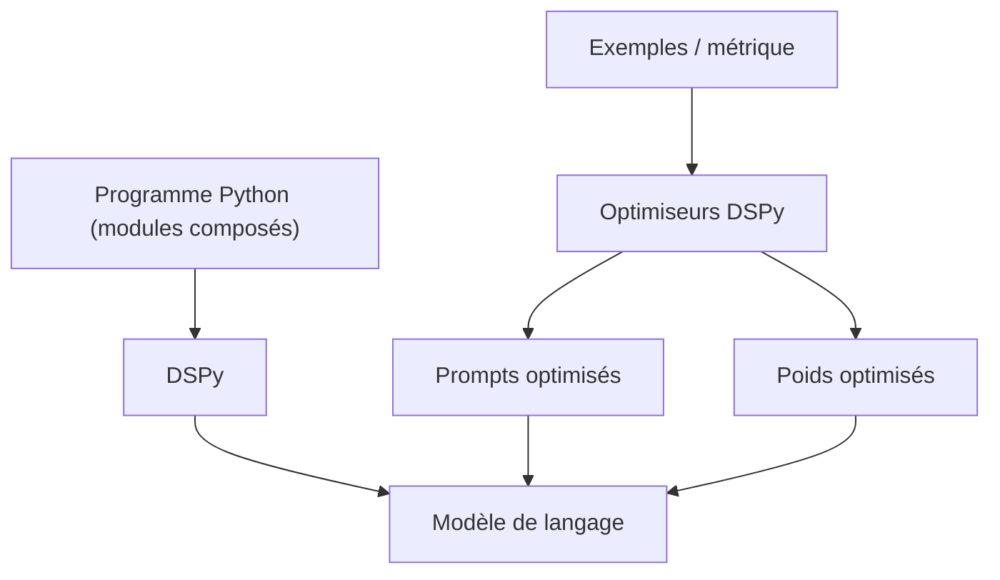

# stanfordnlp/dspy

> Framework for programming modular AI systems and optimizing their prompts and weights.

## The problem
A system built on hand-written prompts breaks at the slightest model change, and
improving it amounts to fumbling around with strings.

## What it actually does
Has you write composable Python code instead of prompts: DSPy stands for *Declarative
Self-improving Python*.
Provides optimization algorithms that act on both prompts and weights.
Targets simple classifiers as well as elaborate RAG pipelines or agent loops.
The rest — modules, signatures, optimizers — is deferred to the documentation site dspy.ai.

## How it is wired


## Trying it
```bash
pip install dspy
pip install git+https://github.com/stanfordnlp/dspy.git
```

## Cost and gotchas
The library is free; optimization multiplies calls to the model, and therefore the bill,
since it evaluates many variants. The README gives neither Python prerequisites nor a code
example: everything is on dspy.ai.

## What it is not
It is not documented here: the README fits on one page and points to the site, which makes it
impossible to evaluate the tool from the repository alone. It is not an agent framework in the orchestration sense:
it produces and optimizes the calls, it manages neither durable state nor resumption.

## Alternatives
No alternative named in the README.

## For you
The right answer when your prompts have become an asset to maintain rather than a draft.
