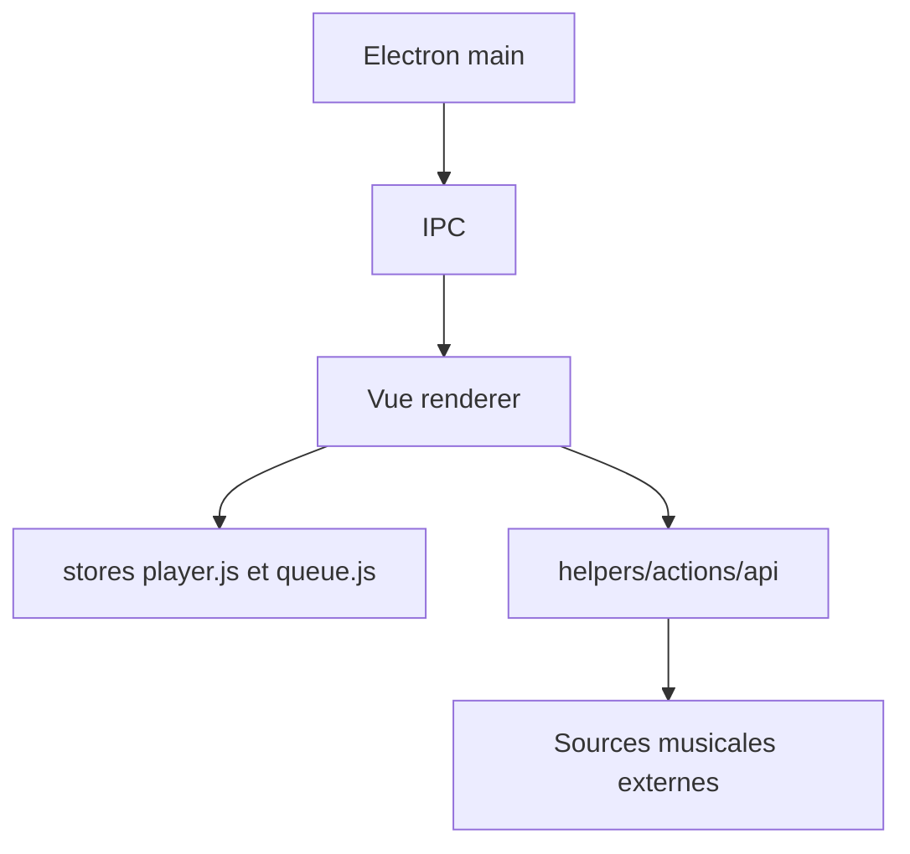

# staniel359/muffon

> A desktop music client that aggregates several streaming sources to discover and organize your music.

## The problem
Listening to and exploring music spread across several services forces you to juggle between applications.

## What it actually does
Electron and Vue application for Windows, macOS and Linux. It fetches audio, video and metadata from Last.fm, Bandcamp, Deezer, SoundCloud, YouTube Music, Genius, Discogs and others. Features: queue, library, playlists, recommendations, Last.fm scrobbling, Discord Rich Presence, lyrics. Spotify and Yandex Music are noted as out of service.

## How it is wired


## Trying it
```bash
xattr -d com.apple.quarantine /Applications/muffon.app
```
This command is only for macOS after installing the binary from the releases.

## Cost and gotchas
Free, but depends on third-party services, some of which no longer work. Unsigned applications: Windows and macOS warnings to work around.

## What it is not
Not a download or piracy tool: the README rules it out. Contributions made with AI are refused by the team.

## Alternatives
No alternative named in the README.

## For you
Ignore: a mainstream music player, unrelated to data, AI or MLOps work, and dependent on unstable external sources.
