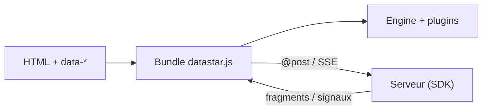

# starfederation/datastar

> Lightweight hypermedia framework: page-side reactivity through `data-*` attributes, with updates pushed by the server.

## The problem
Building a reactive or real-time interface often requires a heavy JavaScript framework and a single-page application.

## What it actually does
A script tag (v1.0.3, 11.81 KiB according to the README) adds signals and the attributes `data-bind`, `data-text`, `data-on`; events call the server (`@post`), which replies with HTML fragments or signals, through server-sent events (SSE). The repository also contains server SDKs in many languages, a website, examples and editor extensions.

## How it is wired


## Trying it
```bash
# Aucune commande shell ; le README propose une balise script :
# <script type="module" src="https://cdn.jsdelivr.net/gh/starfederation/datastar@v1.0.3/bundles/datastar.js"></script>
```

## Cost and gotchas
Free. The README is short (getting-started guide linked). The architecture graph cites a 14.5 KiB script, different from the README's figure.

## What it is not
Not a server framework: you need a back end that sends HTML or events.

## Alternatives
No alternative named in the README.

## For you
Keep an eye on it: interesting for lightweight real-time dashboards without a JavaScript build chain; irrelevant for model training.
