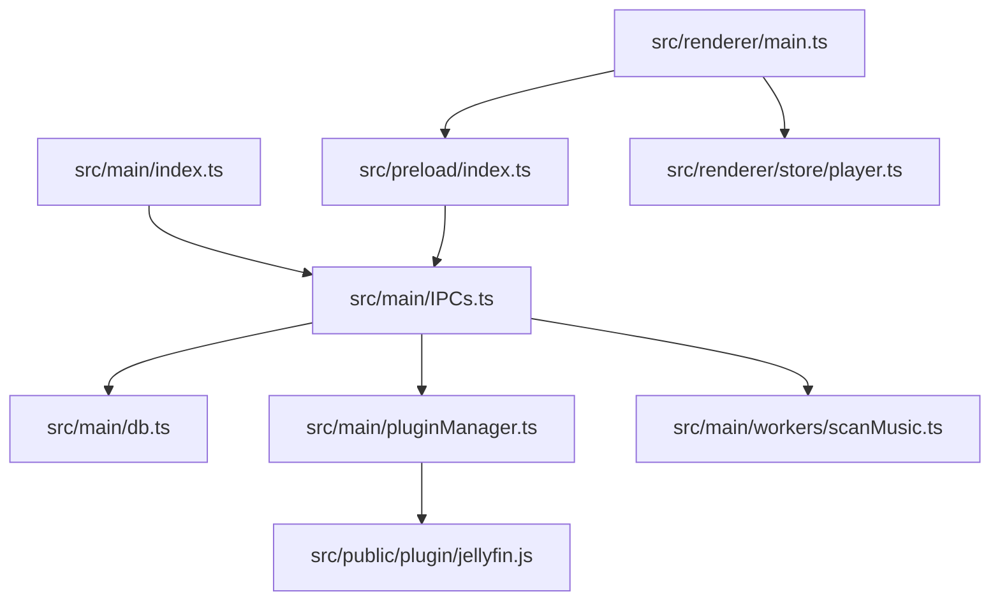

# stark81/VutronMusic

> Desktop music player (Electron, Vue 3) for local files, streaming servers and online platforms via plugins.

## The problem
Listening to your local music, your Navidrome/Jellyfin/Emby server and Chinese platforms requires several applications with different interfaces.

## What it actually does
The Electron main process manages a SQLite database, scan workers and a plugin manager, exposed through IPCs.ts. The Vue interface goes through the preload; the player and audioEngine stores drive playback. Word-by-word lyrics, embedded cover art, audio effects, pitch and speed changes, lyrics in the macOS menu bar.

## How it is wired


## Trying it
```bash
yarn install
yarn dev
yarn build
```

## Cost and gotchas
Free. Requires Node.js 22.6+ and Yarn 1.22.22. No ready-made package is mentioned in the README, so you have to build it. Personal, non-commercial use requested.

## What it is not
Not a music provider: it plays your files or connects to third-party services you have access to.

## Alternatives
YesPlayMusic is cited as the inspiration for the interface.

## For you
Ignore: consumer player with no link to data, AI or MLOps.
