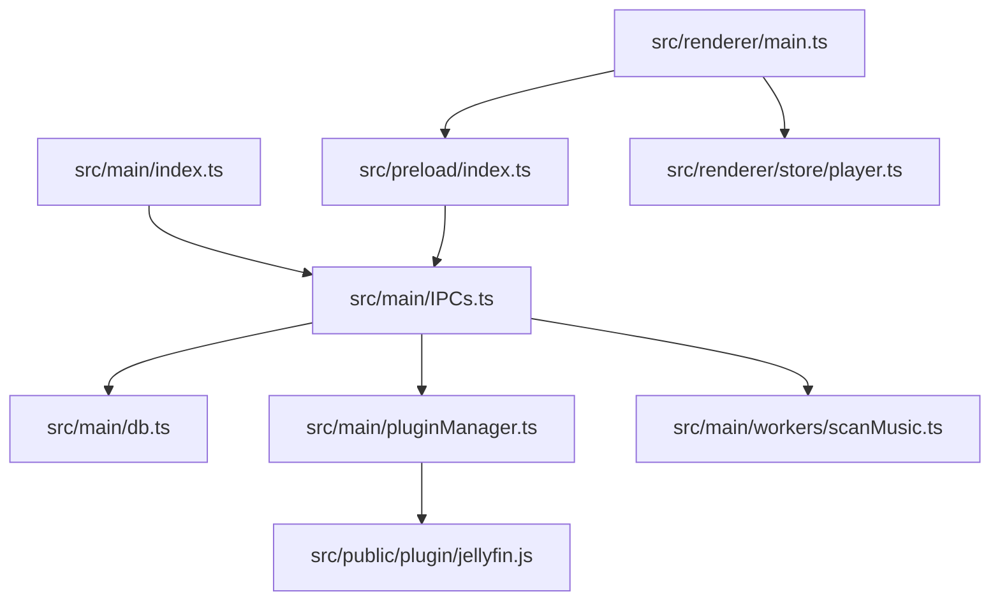

# stark81/VutronMusic

> Lecteur de musique de bureau (Electron, Vue 3) pour fichiers locaux, serveurs de streaming et plateformes en ligne via des plugins.

## Le problème
Écouter sa musique locale, son serveur Navidrome/Jellyfin/Emby et des plateformes chinoises demande plusieurs applications aux interfaces différentes.

## Ce que ça fait vraiment
Le processus principal Electron gère une base SQLite, des workers de scan et un gestionnaire de plugins, exposés par IPCs.ts. L'interface Vue passe par le preload ; les stores player et audioEngine pilotent la lecture. Paroles mot à mot, couverture intégrée, effets audio, changement de tonalité et de vitesse, paroles dans la barre de menus macOS.

## Comment c'est branché


## Essayer
```bash
yarn install
yarn dev
yarn build
```

## Coût et pièges
Gratuit. Exige Node.js 22.6+ et Yarn 1.22.22. Aucun paquet prêt à l'emploi n'est cité dans le README, il faut compiler. Usage personnel et non commercial demandé.

## Ce que ce n'est pas
Pas un fournisseur de musique : il lit tes fichiers ou se branche sur des services tiers dont tu as les accès.

## Alternatives
YesPlayMusic est cité comme source d'inspiration de l'interface.

## Pour toi
À ignorer : lecteur grand public sans lien avec la data, l'IA ou le MLOps.

