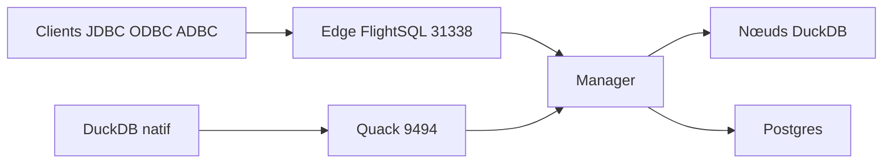

# starlake-ai/quack-on-demand

> Multi-tenant gateway serving DuckDB and DuckLake with fine-grained security and Arrow Flight SQL.

## The problem
DuckDB has no network listener, no users and no permissions: opening it to several teams requires building that layer yourself.

## What it actually does
Starts DuckDB nodes on demand, routes each query to the least loaded node and applies per-table permissions, row filters and column masking. Exposes Arrow Flight SQL (JDBC, ODBC, ADBC) and a native Quack protocol. Relies on Postgres for the control plane, embedded in the demo. Also handles snapshots, branches for agents, audit and encryption.

## How it is wired
Simplified diagram based on the sheet, no diagram provided.



## Trying it
```bash
uvx qod@latest serve --demo
uvx qod@latest serve ./sales.duckdb
docker run --rm -p 20900:20900 -p 31338:31338 starlakeai/quack-on-demand demo
```

## Cost and gotchas
Free, but production requires your own Postgres and object storage. Demo mode is deliberately insecure. Each query goes to a single node: no distributed queries.

## What it is not
Not a distributed engine like Trino or Dremio, nor a simple embedded DuckDB. Repository created in May 2026: young.

## Alternatives
- Trino, Dremio, StarRocks: preferable for distributed queries on very large volumes.
- DuckDB alone: sufficient for embedded use in a single application.

## For you
Worth watching: very relevant if you expose a DuckDB or DuckLake warehouse to several teams with masking, but young and with many moving parts to operate.
