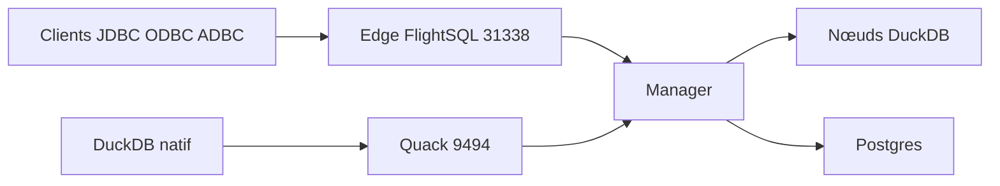

# starlake-ai/quack-on-demand

> Passerelle multi-tenant qui sert DuckDB et DuckLake avec sécurité fine et Arrow Flight SQL.

## Le problème
DuckDB n'a ni écoute réseau, ni utilisateurs, ni droits : l'ouvrir à plusieurs équipes demande de construire soi-même cette couche.

## Ce que ça fait vraiment
Démarre des nœuds DuckDB à la demande, achemine chaque requête vers le nœud le moins chargé et applique droits par table, filtres de lignes et masquage de colonnes. Expose Arrow Flight SQL (JDBC, ODBC, ADBC) et un protocole Quack natif. S'appuie sur Postgres pour le plan de contrôle, embarqué en démo. Gère aussi snapshots, branches pour agents, audit et chiffrement.

## Comment c'est branché
Schéma simplifié d'après la fiche, sans diagramme fourni.



## Essayer
```bash
uvx qod@latest serve --demo
uvx qod@latest serve ./sales.duckdb
docker run --rm -p 20900:20900 -p 31338:31338 starlakeai/quack-on-demand demo
```

## Coût et pièges
Gratuit, mais la production exige un Postgres et un stockage objet à toi. Le mode démo est volontairement non sécurisé. Chaque requête va sur un seul nœud : pas de requête distribuée.

## Ce que ce n'est pas
Pas un moteur distribué comme Trino ou Dremio, ni un DuckDB embarqué simple. Dépôt créé en mai 2026 : jeune.

## Alternatives
- Trino, Dremio, StarRocks : à préférer pour des requêtes distribuées sur de très gros volumes.
- DuckDB seul : suffisant pour un usage embarqué dans une seule application.

## Pour toi
À surveiller : très pertinent si tu exposes un entrepôt DuckDB ou DuckLake à plusieurs équipes avec masquage, mais jeune et riche en pièces à exploiter.

