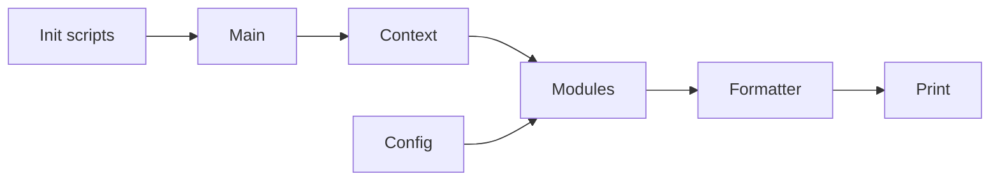

# starship/starship

> A configurable command prompt that works in all shells and on all systems.

## The problem
The default prompt for each shell is lacking in information and is configured differently in various locations.

## What it actually does
The Rust binary inspects the context (directory, Git repository, language, cloud, etc.), executes appropriate modules, assembles their segments using a format language, and returns a command to the shell. A shell initialization script (Bash, Zsh, Fish, PowerShell, Nushell, etc.) then sets it up. The configuration is in TOML format, with pre-defined settings.

## How it is wired


## Trying it
```sh
curl -sS https://starship.rs/install.sh | sh
eval "$(starship init bash)"
```

## Cost and gotchas
Free. Requires the Nerd Font to be installed in the terminal. The installation script runs over the network.

## What it is not
It's not a shell or a plugin manager; it only handles the prompt. The README states that the program does not transmit any information to network systems except as explicitly requested by the user.

## Alternatives
Sources of inspiration: spaceship-prompt, robbyrussell-node, silver.

## For you
To adopt: immediate gain in comfort, allowing you to quickly view the Git branch, Python environment, or cloud context.
