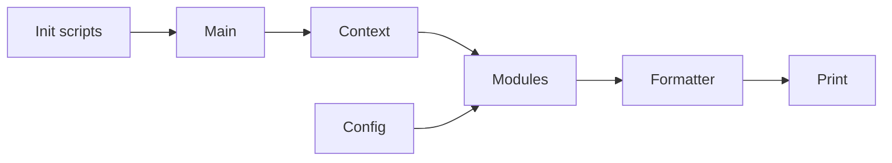

# starship/starship

> Invite de commande configurable qui fonctionne dans tous les shells et sur tous les systèmes.

## Le problème
L'invite par défaut de chaque shell est pauvre en information et se configure différemment partout.

## Ce que ça fait vraiment
Le binaire Rust inspecte le contexte (dossier, dépôt Git, langage, cloud…), exécute des modules adaptés, assemble leurs segments via un langage de format et renvoie une invite au shell. Un script d'initialisation par shell (Bash, Zsh, Fish, PowerShell, Nushell…) le branche. La configuration est en TOML, avec des presets.

## Comment c'est branché


## Essayer
```sh
curl -sS https://starship.rs/install.sh | sh
eval "$(starship init bash)"
```

## Coût et pièges
Gratuit. Nécessite une police Nerd Font installée dans le terminal. Le script d'installation s'exécute depuis le réseau.

## Ce que ce n'est pas
Pas un shell ni un gestionnaire de plugins : il ne gère que l'invite. Le README annonce que le programme ne transmet rien à des systèmes réseau sauf demande de l'utilisateur.

## Alternatives
Inspirations citées : spaceship-prompt, robbyrussell-node, silver.

## Pour toi
À adopter : gain de confort immédiat pour voir branche Git, environnement Python ou contexte cloud en un coup d'œil.

