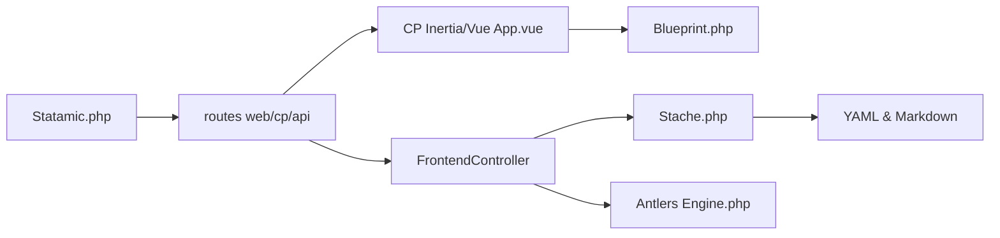

# statamic/cms

> "Flat-first" CMS built on Laravel and Git, installed as a Composer package in an existing Laravel app.

## The problem
Building editable sites without a heavy database, with versioned content.

## What it actually does
A Composer package for Laravel. Content (entries, taxonomies, globals, assets) lives in YAML/Markdown; the "Stache" indexes it and exposes it through repositories and query builders. Inertia/Vue control panel, Antlers templating engine (or Blade), static caching, REST and GraphQL API, Comb/Algolia search, Git integration, add-on system.

## How it is wired

## Trying it
No command documented in the README (docs at statamic.dev; separate application repository).

## Cost and gotchas
Prerequisite: a Laravel (PHP) application. License not identified by GitHub; the README says nothing about a possible paid tier (marketplace/licensing are present in the code).

## What it is not
Not a ready-to-use application: this repository is the core of the package, the preconfigured app is elsewhere.

## Alternatives
No alternative named in the README.

## For you
Ignore: a PHP web CMS, far from data/AI/MLOps work.
