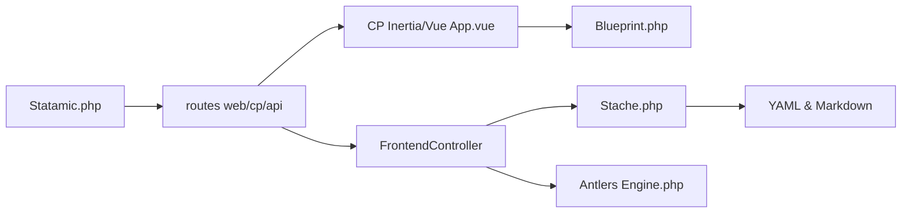

# statamic/cms

> CMS « flat-first » sur Laravel et Git, installé comme paquet Composer dans une appli Laravel existante.

## Le problème
Construire des sites éditables sans base de données lourde, avec contenu versionné.

## Ce que ça fait vraiment
Paquet Composer pour Laravel. Le contenu (entrées, taxonomies, globals, assets) vit en YAML/Markdown ; la « Stache » l'indexe et l'expose via dépôts et query builders. Panneau de contrôle Inertia/Vue, moteur de templates Antlers (ou Blade), cache statique, API REST et GraphQL, recherche Comb/Algolia, intégration Git, système d'add-ons.

## Comment c'est branché

## Essayer
Aucune commande documentée dans le README (doc sur statamic.dev ; repo d'application séparé).

## Coût et pièges
Prérequis : une application Laravel (PHP). Licence non identifiée par GitHub ; le README ne dit rien d'un éventuel volet payant (marketplace/licensing présents dans le code).

## Ce que ce n'est pas
Pas une application prête à l'emploi : ce dépôt est le cœur du paquet, l'appli préconfigurée est ailleurs.

## Alternatives
Aucune alternative nommée dans le README.

## Pour toi
À ignorer : CMS web PHP, éloigné d'un travail data/IA/MLOps.

